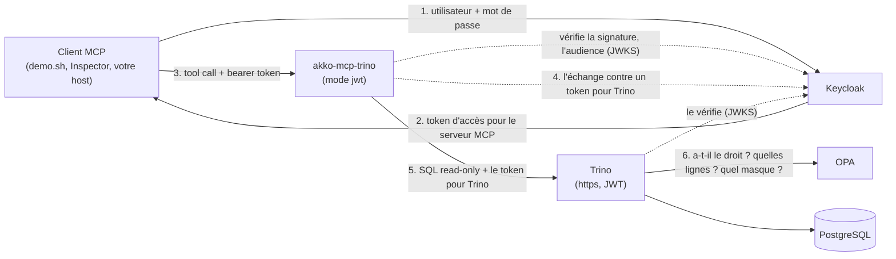

# akko-sandbox

[](https://github.com/AKKO-p/akko-sandbox/actions/workflows/smoke.yml)

<p align="center"></p>

**Trois comptes, une question, trois issues.** Un sandbox de cinq minutes pour
[akko-mcp-trino](https://github.com/AKKO-p/akko-mcp-trino), le serveur MCP open
source qui donne aux agents d'IA un accès en lecture seule à Trino, chaque
utilisateur avec ses propres droits.

[English](README.md)

Deux utilisateurs posent la même question par MCP. akko-mcp-trino vérifie le
token de chacun, émis pour le serveur, et l'échange auprès de Keycloak contre un
token émis pour Trino : le token de l'utilisateur ne va jamais plus loin. Trino
vérifie ce token, exécute la requête au nom de cet utilisateur et demande à une
policy ce qu'il peut voir.
L'analyste obtient cinq clients européens aux adresses e-mail masquées ;
l'administratrice obtient les dix, en clair. Le serveur ne décide rien de tout cela.

## Démarrer

Il faut Docker avec Compose v2, environ 2,5 Go de mémoire libre, et les ports
`8080`, `3000` et `6274` libres sur `localhost`.

```bash
git clone https://github.com/AKKO-p/akko-sandbox.git
cd akko-sandbox
docker compose up -d --wait
./demo.sh
```

Le premier démarrage télécharge les images (environ 1,7 Go sur disque). Ensuite,
le sandbox est prêt en une minute environ. Pour tout arrêter et tout
supprimer : `docker compose down -v`.

## Ce que montre `demo.sh`

1. La même question SQL, envoyée par le client MCP officiel à l'outil `execute_query`.
2. `SELECT current_user` : Trino exécute chaque requête au nom de l'utilisateur dont il a reçu le token.
3. Les deux réponses côte à côte : e-mails masqués et row filter pour l'analyste, tout pour l'administratrice.
4. Un troisième utilisateur, `dave_viewer`, refusé par la policy.
5. La même recherche de colonne pour carol et pour dave (`search_columns`, depuis akko-mcp-trino 0.7) : le mot `email` trouve `demo.crm.customers.email` pour carol, et rien pour dave, à qui la policy cache la table. Sa recherche est pourtant complète, rien n'a été sauté : cette table n'est simplement pas visible pour lui.
6. Une écriture, refusée par le serveur avant d'atteindre Trino.
7. Une requête sans token, une autre avec une signature falsifiée, et une troisième avec un token valide mais émis pour Trino au lieu du serveur : les trois refusées par un `401`.

`./demo.sh --check` joue les mêmes étapes sous forme d'assertions.

## Utilisateurs

Des comptes de démonstration, avec un mot de passe de démonstration. Ne les
réutilisez jamais ailleurs.

| Utilisateur | Mot de passe | Voit |
|---|---|---|
| `alice_admin` | `demo` | toutes les lignes, toutes les colonnes en clair |
| `carol_analyst` | `demo` | les clients européens seulement, adresses e-mail masquées ; aucun versement de salaire parmi les transactions, aucune date d'ouverture de compte |
| `dave_viewer` | `demo` | tout sauf la table des clients et la colonne `balance` des comptes |

La console Keycloak est sur <http://localhost:8080> (`admin` / `admin`).

## Ce qui tourne

| Service | Image | Rôle | Limite mémoire |
|---|---|---|---|
| `certs` | `alpine/openssl:3.5.9` | crée une autorité de certification de démonstration, les certificats de Trino et de Keycloak et le secret client du serveur MCP, puis s'arrête | 32 Mo |
| `postgres` | `postgres:17.11-alpine` | les données fictives : clients, comptes, transactions, avec des commentaires sur les tables et les colonnes, et douze tables d'archive vides (`crm_archive`) | 128 Mo |
| `keycloak` | `quay.io/keycloak/keycloak:26.7.5` | l'identity provider (IdP), realm `sandbox`, avec le token exchange standard | 768 Mo |
| `opa` | `openpolicyagent/opa:1.21.1-static` | la policy d'accès, [`opa/policy.rego`](opa/policy.rego) | 64 Mo |
| `trino` | `trinodb/trino:482` | le moteur, en https, authentification JWT, contrôle d'accès OPA | 2048 Mo |
| `mcp` | `akkoai/akko-mcp-trino:0.7.2` | le serveur MCP, avec ses valeurs par défaut : mode d'identité `jwt` (token exchange), token valide exigé | 256 Mo |
| `inspector` | `ghcr.io/modelcontextprotocol/inspector:2.9.0` | l'Inspector MCP officiel | 384 Mo |

Mesuré sur une machine Linux avec `docker stats` : environ 1,4 Go utilisés au repos
(1460 Mio), environ 1,7 Go au plus fort de la démo (1740 Mio). Trino et Keycloak
en prennent l'essentiel (970 et 550 Mio au plus fort) ; le serveur MCP, environ 75 Mio.

Trino tourne avec `MALLOC_ARENA_MAX=2` et 2048 Mo. Les recherches de
`search_columns` et de `describe_schema` lui posent beaucoup de requêtes de
métadonnées ; avec 1280 Mo, sa mémoire hors tas dépasse la limite et le noyau
le tue. La glibc donne à chaque thread sa propre arène malloc, et avec les
nombreux threads de Trino elles ajoutent environ 0,5 Go ; deux arènes les reprennent.

Seuls Keycloak (`8080`), le serveur MCP (`3000`) et l'Inspector (`6274`) sont
publiés, et sur `127.0.0.1` seulement. `KEYCLOAK_PORT`, `MCP_PORT` et
`INSPECTOR_PORT` changent ces ports.

## Comment les pièces s'assemblent



- Le serveur MCP vérifie la signature du token, son issuer (`http://localhost:8080/realms/sandbox`), son audience (`akko-mcp`, le serveur lui-même) et son expiration, et refuse toute requête sans token valide. Un token émis pour Trino est refusé aussi.
- Il échange le token auprès de Keycloak, en https, contre un token dont l'audience est `trino` (OAuth 2.0 Token Exchange, RFC 8693), avec son propre client `akko-mcp`. Le token de l'utilisateur n'est jamais transmis.
- Il envoie ce token à Trino, en https uniquement, en vérifiant le certificat de Trino avec l'autorité du sandbox.
- Trino vérifie le token et exécute la requête au nom de son `preferred_username`.
- Trino interroge OPA avant chaque action. Toute la policy tient dans [un court fichier Rego](opa/policy.rego) : qui peut lire quoi, deux colonnes cachées, un catalogue caché, une table témoin cachée à tous, le masque des e-mails, deux row filters, et personne n'agit sous le nom d'un autre utilisateur.

Pour changer ce que voit un utilisateur, modifiez `opa/policy.rego` puis lancez
`docker compose restart opa`. Le serveur MCP ne change pas.

## Cliquer : l'Inspector MCP

1. Ouvrez l'adresse affichée par l'Inspector : `docker compose logs inspector | grep MCP_INSPECTOR_API_TOKEN`.
2. **Add Servers**, puis **+ Add manually**. Donnez un identifiant, choisissez le transport `streamable-http` et l'URL `http://mcp:3000/mcp` (l'Inspector tourne dans le réseau du compose). Cliquez sur **Add**.
3. Récupérez un token avec `./token.sh carol_analyst`. Sur la carte du serveur, ouvrez **Settings**, puis **Custom Headers**, **+ Add Header** : `Authorization` et `Bearer <token>`. Fermez les réglages.
4. Passez la carte en **Connected**, puis appelez `execute_query` avec `SELECT * FROM demo.crm.customers`. Recommencez avec le token d'alice.

## Brancher votre propre host MCP

Claude Desktop, Cursor, VS Code et Claude Code peuvent utiliser le serveur du
sandbox, `http://localhost:3000/mcp`, avec le token d'un utilisateur. Voir
[docs/connect-a-host.fr.md](docs/connect-a-host.fr.md).

## Tester

```bash
tests/smoke.sh
```

Le test démarre le sandbox sous son propre nom de projet, joue la démo,
vérifie les deux réponses différentes, `current_user`, chaque refus (à la porte
du serveur et chez Trino), le token exchange (lu dans les événements de Keycloak), la ligne d'audit et l'Inspector,
affiche le temps de démarrage et la mémoire, puis supprime tout. `KEEP=1` le
laisse tourner. `MCP_IMAGE` lance une autre version du serveur, par exemple une
release candidate.

## Derrière Trino Gateway

Le même sandbox peut tourner avec [Trino Gateway](https://trinodb.github.io/trino-gateway/)
devant deux clusters Trino. Le serveur MCP ne joint alors que le gateway : il
n'est pas sur le réseau des clusters, donc chaque requête, chaque page suivante
et chaque annulation passent par le gateway. Le gateway n'écoute qu'en https et
termine le TLS, et chaque cluster lit le protocole transmis
(`http-server.process-forwarded=true`). Sa propre API (backends, historique des
requêtes) demande son compte d'administration, dont le mot de passe est tiré au
hasard dans le volume `certs` et n'est pas lisible par le serveur MCP.

```bash
COMPOSE_FILE=compose.yaml:gateway/compose.gateway.yaml docker compose up -d --wait
COMPOSE_FILE=compose.yaml:gateway/compose.gateway.yaml ./demo.sh --check
COMPOSE_FILE=compose.yaml:gateway/compose.gateway.yaml docker compose --profile tools down -v
tests/gateway.sh   # les contrôles, de bout en bout
```

Cette variante fait tourner deux Trino de 2048 Mo chacun. Mesurée avec `docker stats`,
elle atteint 3058 Mio au plus fort de `tests/gateway.sh` et 3220 Mio pendant les
contrôles de la 0.7 : comptez environ 4 Go de mémoire libre.

Démarrez la variante avec le même `COMPOSE_FILE` à chaque fois, et arrêtez-la
avec lui aussi : un `docker compose down` sans lui laisse derrière lui le second
cluster et le gateway.

`tests/gateway.sh` vérifie qu'un second démarrage est sain, les deux réponses
différentes à travers le gateway, que le serveur ne peut ni joindre un cluster
directement ni utiliser l'API d'administration du gateway, que le gateway refuse
les en-têtes de transfert envoyés par un client, que les requêtes se répartissent
sur les deux clusters et que chaque cluster les exécute au nom de l'utilisateur
qui a demandé, qu'un résultat plafonné passe par le gateway, qu'une requête qui
dépasse son délai est annulée dans Trino à travers le gateway, et que les refus
restent les mêmes. Il utilise les ports du sandbox (8080, 3000, 6274) ;
pour le lancer à côté d'un sandbox démarré, fixez les ports comme dans
l'en-tête du script. La CI le lance après `tests/smoke.sh`.

## Les outils d'akko-mcp-trino 0.7

```bash
tests/v07.sh
GATEWAY=1 tests/v07.sh   # les mêmes contrôles derrière Trino Gateway
```

`tests/v07.sh` vérifie les outils qu'akko-mcp-trino 0.7 ajoute ou change, sur le
sandbox complété par [`tests/compose.v07.yaml`](tests/compose.v07.yaml) (des
pages de cinq noms, des pages de `describe_schema` de quatre tables et dix
colonnes au plus, et deux catalogues de plus pris dans
[`tests/v07/catalog`](tests/v07/catalog), `tpch` et `tpcds`, générés par Trino,
le second caché aux viewers par la policy ; avec `GATEWAY=1`,
[`tests/compose.v07.gateway.yaml`](tests/compose.v07.gateway.yaml) les donne
aussi au second cluster) : `search_columns` trouve `transactions.amount` par le mot
`revenue` de son commentaire ; `dave_viewer` n'obtient rien de `crm.customers`,
de la colonne `balance` des comptes ni du catalogue `tpcds`, par aucun outil,
messages d'erreur compris, tant qu'il ne les nomme pas lui-même (voir plus bas),
alors que carol ou alice obtiennent chacun d'eux ; sa recherche dans tous les
catalogues fouille chaque schéma de `demo` et de `tpch` ; Trino lui-même retire
la colonne de `information_schema.columns`, de `system.jdbc.columns`, de
`SHOW COLUMNS`, de `DESCRIBE` et de `SELECT *` pour lui ; `list_tables` et
`describe_schema` parcourent `crm_archive` page par page, chaque table une fois
et entière ; une recherche avec un budget d'appel court dit ce qu'elle n'a pas
fouillé, et son curseur la reprend jusqu'au bout ; les erreurs portent leur `kind`, Trino arrêté compris ; une policy qui
refuse `system.jdbc` reçoit une erreur qui dit quoi autoriser ; le SQL de l'agent
sur `system` reste refusé et n'atteint jamais le moteur ; le journal du serveur
contient une ligne d'audit pour chaque appel et aucun token. Le script
affiche aussi les plans des requêtes de métadonnées de `describe_schema`.
`V07_SHORT_BUDGET` et `V07_SHORT_RESERVE` (3 et 2 secondes) fixent le budget
court. La CI lance le script après `tests/gateway.sh`.

La policy cache la colonne `balance` aux viewers par deux opérations du
plugin OPA de Trino : `FilterColumns` la retire de chaque listing, et
`SelectFromColumns` refuse une requête qui la nomme. Le sandbox fixe
`opa.policy.batched-uri` : Trino pose `FilterColumns` une fois par listing, à la
règle `batch` de la policy, qui applique `allow` à chaque colonne ; sans ce
réglage, Trino interroge OPA une colonne à la fois, et une table de 200 colonnes
sature sa file. Les masques sont groupés de la même façon
(`opa.policy.batch-column-masking-uri` et la règle `batchColumnMasks`). Trino tourne avec `hide-inaccessible-columns=true`, que nous
conseillons aussi aux administrateurs : `SELECT *` répond alors sans la colonne
cachée. Sans ce réglage, `SELECT *` est refusé, et en Trino 482 ce refus liste
toutes les colonnes de la table, la colonne cachée comprise : c'est le message de
Trino, que le serveur transmet entier. Une requête qui nomme la colonne reste
refusée ; les contrôles lisent le code d'erreur, pas le texte. De même, un
catalogue qu'il nomme reçoit le refus de Trino (`Cannot access catalog tpcds`,
kind `permission`) là où un catalogue absent reçoit `not found` (kind
`catalog`) : Trino distingue les deux.

## Le contexte d'un catalogue de données : Apache Atlas

```bash
COMPOSE_FILE=compose.yaml:catalogs/compose.atlas.yaml COMPOSE_PROFILES=catalogs \
  MCP_IMAGE=<une image d'akko-mcp-trino 0.8> docker compose up -d --wait
MCP_IMAGE=<une image d'akko-mcp-trino 0.8> tests/context.sh
MCP_IMAGE=<une image d'akko-mcp-trino 0.8> GATEWAY=1 tests/context.sh   # derrière Trino Gateway
```

akko-mcp-trino 0.8 lit un catalogue de données et ajoute son contexte à
`describe_table` et à `describe_schema`. Il ne sert ce contexte que pour les tables
et les colonnes que Trino liste à l'appelant. Le profil `catalogs`
([`catalogs/compose.atlas.yaml`](catalogs/compose.atlas.yaml)) ajoute Apache Atlas
2.4.0 et active le fournisseur Atlas du serveur.

La 0.8 n'est pas encore sur Docker Hub. D'ici là, construisez l'image depuis la
branche `main` d'akko-mcp-trino et passez-la dans `MCP_IMAGE`. Le fournisseur
Atlas est livré dans l'image, inactif tant que `MCP_CONTEXT_PROVIDERS` ne le nomme
pas.

Apache Atlas ne publie que ses sources.
[`catalogs/atlas/Dockerfile`](catalogs/atlas/Dockerfile) construit le serveur
depuis la release officielle des sources, vérifiée contre le SHA-512 que l'Apache
Software Foundation publie à côté. HBase 2.5.0 et Solr 8.11.3, les versions que
nomme la release, viennent de l'archive de l'ASF, chacun vérifié contre son
SHA-512. Le premier démarrage construit l'image : le build Maven a pris 7 min 18 s
sur une machine de 16 cœurs, et l'image occupe 2,98 Go. Atlas garde son état dans
son conteneur.

[`catalogs/seed.py`](catalogs/seed.py) écrit le catalogue de démonstration par
l'API REST v2 d'Atlas, en tant qu'admin :

- une description de steward pour chaque table et chaque colonne de crm ;
- le glossaire `Sales`, avec cinq termes, chacun avec un statut : `Customer`,
  rattaché à `crm.customers` seulement, `Account`, `Revenue`, son synonyme
  `Turnover`, et `Opening date` ;
- le glossaire `Compliance`, avec le terme `Personal data`, rattaché à des
  colonnes que tous les utilisateurs voient ;
- une table renommée, une table supprimée et une colonne supprimée ;
- une table sous le cluster Atlas `tpch`, qu'aucun catalogue Trino ne vise.

Le serveur lit Atlas avec `mcp_reader`, un compte du rôle propre à Atlas
`DATA_SCIENTIST`, qui ne peut que lire. Son mot de passe est tiré au hasard dans
le volume `atlas-secrets`. Le catalogue Trino `demo` est le cluster Atlas
`sandbox`. Seul le glossaire `Sales` est servi. Le témoin `demo.mcp.canary` est
une table que la policy cache à tous, administrateurs compris : le serveur ne sert
le contexte à un appelant que tant que Trino la lui cache.

Voici ce que reçoit `carol_analyst` pour la colonne `amount` de
`crm.transactions`, copié d'un passage de `tests/context.sh`. Le terme de
`Compliance`, rattaché à la même colonne, n'y est pas :

```json
{
  "column_context": {
    "amount": {
      "description": "Amount of the movement, in the account's currency",
      "sources": {"description": "atlas"},
      "terms": [{"name": "Revenue", "ref": "t2"}]
    }
  },
  "terms": {
    "t1": {"name": "Turnover", "glossary": "Sales", "definition": "The revenue of a period, added up",
           "status": "draft", "related": [{"ref": "t2", "name": "Revenue", "relation": "synonym"}],
           "source": "atlas"},
    "t2": {"name": "Revenue", "glossary": "Sales", "definition": "Money that comes in from a sale",
           "status": "approved", "related": [{"ref": "t1", "name": "Turnover", "relation": "synonym"}],
           "source": "atlas"}
  },
  "context_sources": {"atlas": "ok", "file": "ok"}
}
```

`tests/context.sh` ajoute [`tests/compose.v08.yaml`](tests/compose.v08.yaml) : un
second fournisseur, `file`, qui donne à deux tables un grain et des jointures, dont
Atlas n'a pas la notion ; le module `fingerprint-audit` ; un délai de 3 secondes
pour le contexte ; et aucun cache, pour que chaque appel relise Atlas et Trino. Il
vérifie que :

- `carol_analyst` reçoit les descriptions, les termes de `Sales` et leur statut,
  dans `describe_table` et dans `describe_schema` ;
- `dave_viewer` ne reçoit rien sur `crm.customers` : ni dans ses réponses, ni dans
  ses lignes d'audit, ni dans son historique de requêtes sur chaque cluster, lu
  par l'admin. Le journal de décisions d'OPA ne nomme la table pour lui que dans
  le filtre de listing propre à Trino, qui l'a refusée : Trino doit la lui
  envoyer pour filtrer son listing. Les requêtes du filtre de visibilité portent
  le tag client `mcp-gate`, et elles seules. La liste des requêtes de Trino n'a pas
  de colonne pour les tags client, donc le contrôle les lit dans `/v1/query` du
  coordinateur ;
- la colonne que la policy cache à carol, `accounts.opened_on`, sort du contexte,
  du grain et des jointures, et son terme n'est pas nommé. C'est la seule colonne
  que voit carol dont aucun contrôle plus ancien ni aucune question d'`agent/`
  n'a besoin. Le terme rattaché à
  `crm.customers` seulement n'est jamais nommé à côté d'une autre table. Rien de
  `Compliance` ne sort ;
- la table renommée est `not_found`, le catalogue `tpch` est `not_mapped`, et la
  table et la colonne supprimées ne sont jamais servies ;
- `profile_table` sur l'`email` masqué, et sur `amount` sous le row filter, donne
  les `rows`, `min` et `max` que calcule `execute_query` pour le même utilisateur ;
- une policy qui rend le témoin visible donne `not_checked` et un seul
  avertissement, qui ne nomme personne et rien ;
- Atlas arrêté donne `unavailable`, et l'appel répond quand même. Atlas figé
  au-delà du délai donne `unavailable` dans le budget de l'appel ;
- un compte refusé coûte une connexion à Atlas, puis aucune tant que son fichier de
  secret ne change pas, et le serveur journalise `atlas refused the account` une
  fois. Atlas ne journalise pas les connexions qu'il refuse : avec
  `ATLAS_LOG_REFUSED_LOGINS=true`, que seul `tests/compose.v08.yaml` fixe,
  [`catalogs/atlas/start.sh`](catalogs/atlas/start.sh) les écrit dans
  `/data/logs/logins.log`, jamais avec un mot de passe.

Testé avec Apache Atlas 2.4.0 construit par
[`catalogs/atlas/Dockerfile`](catalogs/atlas/Dockerfile), `trinodb/trino:482`,
`quay.io/keycloak/keycloak:26.7.5`, `openpolicyagent/opa:1.21.1-static`, et
akko-mcp-trino construit depuis sa branche `main` au commit `0e0159c` (il annonce
la version 0.7.2). Le passage sans gateway s'est terminé avec 92 contrôles réussis et un
en échec :

```text
== 8. A slow Atlas: the call answers in time, the request is cancelled
  describe_table answered in 3.7 s, the context deadline being 3 s
  OK    carol, describe_table transactions with Atlas frozen: atlas unavailable, file ok
  OK      the columns and the file's grain still come
  OK      within the deadline and the token round trips: under 8 s
  FAIL  Atlas's side: the request's connection, closed by the client before Atlas read it (got closed by the client 0, open with a request unread 1, expected closed by the client 1, open with a request unread 0)
  OK    Atlas back: the context comes again
```

L'appel répond à temps, mais le serveur laisse ouverte la connexion de la requête :
Atlas garde la requête qu'il n'a pas lue. Ce contrôle reste rouge tant que le
serveur ne la ferme pas.

Derrière le gateway (`GATEWAY=1`), le passage s'est terminé de la même façon : 92
contrôles réussis, et le même en échec. L'historique des requêtes est lu sur
chacun des deux clusters.

Avec akko-mcp-trino 0.7.2, `tests/context.sh` s'arrête au démarrage : ce serveur
ne connaît pas le module `fingerprint-audit`.

```text
mcp-1         | ValueError: unknown extension 'fingerprint-audit'; installed extensions: none
```

Mémoire au repos, mesurée avec `docker stats` juste après le démarrage, sans
gateway : Atlas 2 Gio (limite 3 Gio), Trino 801,6 Mio, Keycloak 522,9 Mio, le
serveur MCP 72,6 Mio, l'Inspector 50,36 Mio, PostgreSQL 26,88 Mio, OPA 18,58 Mio.
Comptez environ 4 Go de mémoire libre ; le démarrage prend environ cinq minutes et
demie (322 s), surtout pour Atlas.

Derrière le gateway, au repos : Atlas 1,957 Gio, les deux Trino 769,1 et
767,4 Mio, Keycloak 556,2 Mio, le gateway 333,8 Mio, le serveur MCP 72,61 Mio.
Comptez environ 5 Go de mémoire libre.

## Un agent réel : combien d'appels jusqu'à la bonne colonne

[`agent/`](agent/README.md) pose à un vrai modèle (Mistral ou Anthropic, par leurs
API) cinq questions sur les données d'exemple, par MCP, en tant que
`carol_analyst`, et compte les appels d'outils jusqu'à la réponse finale, l'appel
où une colonne attendue apparaît pour la première fois, les tokens, et si la
réponse nomme les bonnes colonnes. Lancés contre deux images du serveur avec le
même modèle et les mêmes réglages, les rapports se comparent ligne à ligne.
`--dry-run` liste les outils sans modèle ni clé.

## Mesurer : des résultats datés et une porte contre les régressions

[`bench/`](bench/README.md) joue ces contrôles par un seul point d'entrée,
`bench/run.sh <axe>`, après un contrôle préalable qui refuse une machine sans la
mémoire nécessaire. Chaque passage écrit un résultat daté dans `bench/results/`,
chaque contrôle sous un identifiant stable, avec les images par empreinte, l'état
de la machine et le pic de mémoire de chaque suite, et le compare à la baseline de
son couple (version du serveur, modèle) : un contrôle qui passait et échoue, ou qui
n'a pas tourné, fait échouer le passage. Le dossier porte aussi le détecteur de
marqueurs, qui cherche les noms cachés dans chaque canal qu'atteint un lecteur, le
script k6 validé contre l'Inspector MCP, et l'intervalle de Wilson du harnais
d'agent.

## Pas pour la production

Tout ici est choisi pour démarrer en une commande sur un portable : un Keycloak
de développement (http pour le navigateur, https pour le token exchange), une
connexion par mot de passe, un seul mot de passe pour tous, une autorité de
certification auto-signée, un secret client rangé dans un volume partagé, un
secret partagé de Trino fixe, une policy qui contient trois noms. Derrière le
gateway, chaque cluster fait confiance à `X-Forwarded-Proto` venant de n'importe
quel pair de son réseau : en production, seul le gateway doit joindre un cluster. Le gateway est lancé par `java -jar` et
le chemin du jar dans son image, qu'une montée de version peut déplacer. Son mot
de passe d'administration et sa clé de session sont lisibles par tous les
services qui tournent en uid 1000 (Keycloak, Trino, le gateway), seul le serveur
MCP ne peut pas les lire. Avec le profil `catalogs`, Atlas
tourne sans TLS, avec des utilisateurs dans un fichier, et HBase et Solr dans son
propre conteneur. L'image d'akko-mcp-trino et
sa configuration sont celles de la production ; le reste ne l'est pas.

## À propos d'AKKO

akko-mcp-trino est le cœur open source d'AKKO, un projet français qui construit
une plateforme de données souveraine avec une IA gouvernée. Voir
[akko-ai.com](https://akko-ai.com).

## Licence

[Apache 2.0](LICENSE).
