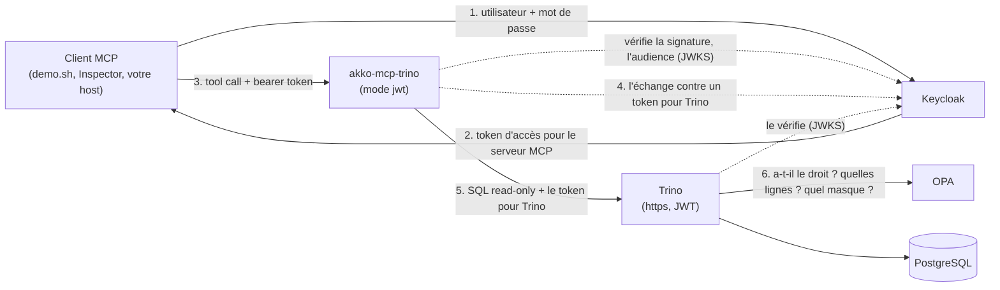

# akko-sandbox

[](https://github.com/AKKO-p/akko-sandbox/actions/workflows/smoke.yml)

<p align="center"></p>

**Trois comptes, une question, trois issues.** Un sandbox de cinq minutes pour
[akko-mcp-trino](https://github.com/AKKO-p/akko-mcp-trino), le serveur MCP open
source qui donne aux agents d'IA un accès en lecture seule à Trino, chaque
utilisateur avec ses propres droits.

[English](README.md)

Deux utilisateurs posent la même question par MCP. akko-mcp-trino vérifie le
token de chacun, émis pour le serveur, et l'échange auprès de Keycloak contre un
token émis pour Trino : le token de l'utilisateur ne va jamais plus loin. Trino
vérifie ce token, exécute la requête au nom de cet utilisateur et demande à une
policy ce qu'il peut voir.
L'analyste obtient cinq clients européens aux adresses e-mail masquées ;
l'administratrice obtient les dix, en clair. Le serveur ne décide rien de tout cela.

## Démarrer

Il faut Docker avec Compose v2, environ 2,5 Go de mémoire libre, et les ports
`8080`, `3000` et `6274` libres sur `localhost`.

```bash
git clone https://github.com/AKKO-p/akko-sandbox.git
cd akko-sandbox
docker compose up -d --wait
./demo.sh
```

Le premier démarrage télécharge les images (environ 1,7 Go sur disque). Ensuite,
le sandbox est prêt en une minute environ. Pour tout arrêter et tout
supprimer : `docker compose down -v`.

## Ce que montre `demo.sh`

1. La même question SQL, envoyée par le client MCP officiel à l'outil `execute_query`.
2. `SELECT current_user` : Trino exécute chaque requête au nom de l'utilisateur dont il a reçu le token.
3. Les deux réponses côte à côte : e-mails masqués et row filter pour l'analyste, tout pour l'administratrice.
4. Un troisième utilisateur, `dave_viewer`, refusé par la policy.
5. La même recherche de colonne pour carol et pour dave (`search_columns`, depuis akko-mcp-trino 0.7) : le mot `email` trouve `demo.crm.customers.email` pour carol, et rien pour dave, à qui la policy cache la table. Sa recherche est pourtant complète, rien n'a été sauté : cette table n'est simplement pas visible pour lui.
6. Une écriture, refusée par le serveur avant d'atteindre Trino.
7. Une requête sans token, une autre avec une signature falsifiée, et une troisième avec un token valide mais émis pour Trino au lieu du serveur : les trois refusées par un `401`.

`./demo.sh --check` joue les mêmes étapes sous forme d'assertions.

## Utilisateurs

Des comptes de démonstration, avec un mot de passe de démonstration. Ne les
réutilisez jamais ailleurs.

| Utilisateur | Mot de passe | Voit |
|---|---|---|
| `alice_admin` | `demo` | toutes les lignes, toutes les colonnes en clair |
| `carol_analyst` | `demo` | les clients européens seulement, adresses e-mail masquées |
| `dave_viewer` | `demo` | tout sauf la table des clients et la colonne `balance` des comptes |

La console Keycloak est sur <http://localhost:8080> (`admin` / `admin`).

## Ce qui tourne

| Service | Image | Rôle | Limite mémoire |
|---|---|---|---|
| `certs` | `alpine/openssl:3.5.9` | crée une autorité de certification de démonstration, les certificats de Trino et de Keycloak et le secret client du serveur MCP, puis s'arrête | 32 Mo |
| `postgres` | `postgres:17.11-alpine` | les données fictives : clients, comptes, transactions, avec des commentaires sur les tables et les colonnes, et douze tables d'archive vides (`crm_archive`) | 128 Mo |
| `keycloak` | `quay.io/keycloak/keycloak:26.7.5` | l'identity provider (IdP), realm `sandbox`, avec le token exchange standard | 768 Mo |
| `opa` | `openpolicyagent/opa:1.21.1-static` | la policy d'accès, [`opa/policy.rego`](opa/policy.rego) | 64 Mo |
| `trino` | `trinodb/trino:482` | le moteur, en https, authentification JWT, contrôle d'accès OPA | 2048 Mo |
| `mcp` | `akkoai/akko-mcp-trino:0.7.2` | le serveur MCP, avec ses valeurs par défaut : mode d'identité `jwt` (token exchange), token valide exigé | 384 Mo |
| `inspector` | `ghcr.io/modelcontextprotocol/inspector:2.9.0` | l'Inspector MCP officiel | 384 Mo |

Mesuré sur une machine Linux avec `docker stats` : environ 1,4 Go utilisés au repos
(1460 Mio), environ 1,7 Go au plus fort de la démo (1740 Mio). Trino et Keycloak
en prennent l'essentiel (970 et 550 Mio au plus fort) ; le serveur MCP, environ 75 Mio.

Trino tourne avec `MALLOC_ARENA_MAX=2` et 2048 Mo. Les recherches de
`search_columns` et de `describe_schema` lui posent beaucoup de requêtes de
métadonnées ; avec 1280 Mo, sa mémoire hors tas dépasse la limite et le noyau
le tue. La glibc donne à chaque thread sa propre arène malloc, et avec les
nombreux threads de Trino elles ajoutent environ 0,5 Go ; deux arènes les reprennent.

Seuls Keycloak (`8080`), le serveur MCP (`3000`) et l'Inspector (`6274`) sont
publiés, et sur `127.0.0.1` seulement. `KEYCLOAK_PORT`, `MCP_PORT` et
`INSPECTOR_PORT` changent ces ports.

## Comment les pièces s'assemblent



- Le serveur MCP vérifie la signature du token, son issuer (`http://localhost:8080/realms/sandbox`), son audience (`akko-mcp`, le serveur lui-même) et son expiration, et refuse toute requête sans token valide. Un token émis pour Trino est refusé aussi.
- Il échange le token auprès de Keycloak, en https, contre un token dont l'audience est `trino` (OAuth 2.0 Token Exchange, RFC 8693), avec son propre client `akko-mcp`. Le token de l'utilisateur n'est jamais transmis.
- Il envoie ce token à Trino, en https uniquement, en vérifiant le certificat de Trino avec l'autorité du sandbox.
- Trino vérifie le token et exécute la requête au nom de son `preferred_username`.
- Trino interroge OPA avant chaque action. Toute la policy tient dans [un court fichier Rego](opa/policy.rego) : qui peut lire quoi, une colonne cachée, un catalog caché, le masque des e-mails, le row filter, et personne n'agit sous le nom d'un autre utilisateur.

Pour changer ce que voit un utilisateur, modifiez `opa/policy.rego` puis lancez
`docker compose restart opa`. Le serveur MCP ne change pas.

## Cliquer : l'Inspector MCP

1. Ouvrez l'adresse affichée par l'Inspector : `docker compose logs inspector | grep MCP_INSPECTOR_API_TOKEN`.
2. **Add Servers**, puis **+ Add manually**. Donnez un identifiant, choisissez le transport `streamable-http` et l'URL `http://mcp:3000/mcp` (l'Inspector tourne dans le réseau du compose). Cliquez sur **Add**.
3. Récupérez un token avec `./token.sh carol_analyst`. Sur la carte du serveur, ouvrez **Settings**, puis **Custom Headers**, **+ Add Header** : `Authorization` et `Bearer <token>`. Fermez les réglages.
4. Passez la carte en **Connected**, puis appelez `execute_query` avec `SELECT * FROM demo.crm.customers`. Recommencez avec le token d'alice.

## Brancher votre propre host MCP

Claude Desktop, Cursor, VS Code et Claude Code peuvent utiliser le serveur du
sandbox, `http://localhost:3000/mcp`, avec le token d'un utilisateur. Voir
[docs/connect-a-host.fr.md](docs/connect-a-host.fr.md).

## Tester

```bash
tests/smoke.sh
```

Le test démarre le sandbox sous son propre nom de projet, joue la démo,
vérifie les deux réponses différentes, `current_user`, chaque refus (à la porte
du serveur et chez Trino), le token exchange (lu dans les propres événements de
Keycloak), la ligne d'audit et l'Inspector, affiche le temps de démarrage et la
mémoire, puis supprime tout. `KEEP=1` le laisse tourner. `MCP_IMAGE` lance une
autre version du serveur, par exemple une release candidate.

## Derrière Trino Gateway

Le même sandbox peut tourner avec [Trino Gateway](https://trinodb.github.io/trino-gateway/)
devant deux clusters Trino. Le serveur MCP ne joint alors que le gateway : il
n'est pas sur le réseau des clusters, donc chaque requête, chaque page suivante
et chaque annulation passent par le gateway. Le gateway n'écoute qu'en https et
termine le TLS, et chaque cluster lit le protocole transmis
(`http-server.process-forwarded=true`). Sa propre API (backends, historique des
requêtes) demande son compte d'administration, dont le mot de passe est tiré au
hasard dans le volume `certs` et n'est pas lisible par le serveur MCP.

```bash
COMPOSE_FILE=compose.yaml:gateway/compose.gateway.yaml docker compose up -d --wait
COMPOSE_FILE=compose.yaml:gateway/compose.gateway.yaml ./demo.sh --check
COMPOSE_FILE=compose.yaml:gateway/compose.gateway.yaml docker compose --profile tools down -v
tests/gateway.sh   # les contrôles, de bout en bout
```

Cette variante fait tourner deux Trino de 2048 Mo chacun. Mesurée avec `docker stats`,
elle atteint 3058 Mio au plus fort de `tests/gateway.sh` et 3220 Mio pendant les
contrôles de la 0.7 : comptez environ 4 Go de mémoire libre.

Démarrez la variante avec le même `COMPOSE_FILE` à chaque fois, et arrêtez-la
avec lui aussi : un `docker compose down` sans lui laisse derrière lui le second
cluster et le gateway.

`tests/gateway.sh` vérifie qu'un second démarrage est sain, les deux réponses
différentes à travers le gateway, que le serveur ne peut ni joindre un cluster
directement ni utiliser l'API d'administration du gateway, que le gateway refuse
les en-têtes de transfert envoyés par un client, que les requêtes se répartissent
sur les deux clusters et que chaque cluster les exécute au nom de l'utilisateur
qui a demandé, qu'un résultat plafonné passe par le gateway, qu'une requête qui
dépasse son délai est annulée dans Trino à travers le gateway, et que les refus
restent les mêmes. Il utilise les ports du sandbox (8080, 3000, 6274) ;
pour le lancer à côté d'un sandbox démarré, fixez les ports comme dans
l'en-tête du script. La CI le lance après `tests/smoke.sh`.

## Les outils d'akko-mcp-trino 0.7

```bash
tests/v07.sh
GATEWAY=1 tests/v07.sh   # les mêmes contrôles derrière Trino Gateway
```

`tests/v07.sh` vérifie les outils qu'akko-mcp-trino 0.7 ajoute ou change, sur le
sandbox complété par [`tests/compose.v07.yaml`](tests/compose.v07.yaml) (des
pages de cinq noms, des pages de `describe_schema` de quatre tables et dix
colonnes au plus, et deux catalogs de plus pris dans
[`tests/v07/catalog`](tests/v07/catalog), `tpch` et `tpcds`, générés par Trino,
le second caché aux viewers par la policy ; avec `GATEWAY=1`,
[`tests/compose.v07.gateway.yaml`](tests/compose.v07.gateway.yaml) les donne
aussi au second cluster) : `search_columns` trouve `transactions.amount` par le mot
`revenue` de son commentaire ; `dave_viewer` n'obtient rien de `crm.customers`,
de la colonne `balance` des comptes ni du catalog `tpcds`, par aucun outil,
messages d'erreur compris, tant qu'il ne les nomme pas lui-même (voir plus bas),
alors que carol ou alice obtiennent chacun d'eux ; sa recherche dans tous les
catalogs fouille chaque schéma de `demo` et de `tpch` ; Trino lui-même retire
la colonne de `information_schema.columns`, de `system.jdbc.columns`, de
`SHOW COLUMNS`, de `DESCRIBE` et de `SELECT *` pour lui ; `list_tables` et
`describe_schema` parcourent `crm_archive` page par page, chaque table une fois
et entière ; une recherche avec un budget d'appel court dit ce qu'elle n'a pas
fouillé, et son curseur la reprend jusqu'au bout ; les erreurs portent leur `kind`, Trino arrêté compris ; une policy qui
refuse `system.jdbc` reçoit une erreur qui dit quoi autoriser ; le SQL de l'agent
sur `system` reste refusé et n'atteint jamais le moteur ; le journal du serveur
contient une ligne d'audit pour chaque appel et aucun token. Le script
affiche aussi les plans des requêtes de métadonnées de `describe_schema`.
`V07_SHORT_BUDGET` et `V07_SHORT_RESERVE` (3 et 2 secondes) fixent le budget
court. La CI lance le script après `tests/gateway.sh`.

La policy cache la colonne `balance` aux viewers par deux opérations du
plugin OPA de Trino : `FilterColumns` la retire de chaque listing, et
`SelectFromColumns` refuse une requête qui la nomme. Le sandbox fixe
`opa.policy.batched-uri` : Trino pose `FilterColumns` une fois par listing, à la
règle `batch` de la policy, qui applique `allow` à chaque colonne ; sans ce
réglage, Trino interroge OPA une colonne à la fois, et une table de 200 colonnes
sature sa file. Les masques sont groupés de la même façon
(`opa.policy.batch-column-masking-uri` et la règle `batchColumnMasks`). Trino tourne avec `hide-inaccessible-columns=true`, que nous
conseillons aussi aux administrateurs : `SELECT *` répond alors sans la colonne
cachée. Sans ce réglage, `SELECT *` est refusé, et en Trino 482 ce refus liste
toutes les colonnes de la table, la colonne cachée comprise : c'est le message de
Trino, que le serveur transmet entier. Une requête qui nomme la colonne reste
refusée ; les contrôles lisent le code d'erreur, pas le texte. De même, un
catalog qu'il nomme reçoit le refus de Trino (`Cannot access catalog tpcds`,
kind `permission`) là où un catalog absent reçoit `not found` (kind
`catalog`) : Trino distingue les deux.

## Le contexte d'un catalogue de données : Apache Atlas

```bash
COMPOSE_FILE=compose.yaml:catalogs/compose.atlas.yaml COMPOSE_PROFILES=catalogs \
  MCP_IMAGE=<une image d'akko-mcp-trino 0.8> docker compose up -d --wait
MCP_IMAGE=<une image d'akko-mcp-trino 0.8> tests/context.sh
MCP_IMAGE=<une image d'akko-mcp-trino 0.8> GATEWAY=1 tests/context.sh   # derrière Trino Gateway
```

akko-mcp-trino 0.8 lit un catalogue de données et ajoute son contexte à
`describe_table` et à `describe_schema`. Il ne sert ce contexte que pour les tables
et les colonnes que Trino montre à l'appelant. Le profil `catalogs`
([`catalogs/compose.atlas.yaml`](catalogs/compose.atlas.yaml)) ajoute Apache Atlas
2.4.0 et active le fournisseur Atlas du serveur.

La version 0.8 n'est pas encore sur Docker Hub. D'ici là, construisez l'image
depuis la branche `main` d'akko-mcp-trino et passez son nom dans `MCP_IMAGE`.
L'image contient le fournisseur Atlas. Il reste inactif tant que
`MCP_CONTEXT_PROVIDERS` ne le nomme pas.

Apache Atlas ne publie que des archives de sources.
[`catalogs/atlas/Dockerfile`](catalogs/atlas/Dockerfile) construit le serveur
depuis l'archive officielle des sources. Le build la vérifie avec le SHA-512 que
l'Apache Software Foundation (ASF) publie à côté. HBase 2.5.0 et Solr 8.11.3, les
versions avec lesquelles cette release est construite, viennent de l'archive de
l'ASF, chacun vérifié avec son SHA-512. Le premier démarrage construit l'image.
Sur une machine de 16 processeurs, le build Maven a pris 7 min 18 s. L'image pèse
2,98 Go. Atlas n'a pas de volume de données : supprimer son conteneur efface le
catalogue de données, et le seed le réécrit au démarrage suivant.

[`catalogs/seed.py`](catalogs/seed.py) écrit le catalogue de données de
démonstration par l'API REST v2 d'Atlas, en tant qu'utilisateur `admin` :

- une description de data steward pour chaque table et chaque colonne de `crm` ;
- le glossaire `Sales`, avec cinq termes, chacun avec un statut : `Customer`
  (rattaché à `crm.customers` seulement), `Account`, `Revenue`, `Turnover` (un
  synonyme de `Revenue`) et `Opening date` ;
- le glossaire `Compliance`, avec le terme `Personal data`, rattaché à des
  colonnes que tous les utilisateurs peuvent voir ;
- une table renommée, une table supprimée et une colonne supprimée ;
- une table sous le cluster Atlas `tpch`, auquel aucun catalog Trino ne
  correspond.

Le serveur lit Atlas en tant que `mcp_reader`, un utilisateur du rôle
`DATA_SCIENTIST`, propre à Atlas, qui ne peut que lire. Son mot de passe est
généré au hasard et rangé dans le volume `atlas-secrets`. Le catalog Trino `demo`
correspond au cluster Atlas `sandbox`. Seul le glossaire `Sales` est servi.

Le profil ajoute ses propres règles à la policy, dans
[`catalogs/policy.rego`](catalogs/policy.rego), qu'OPA ne charge que lorsque
`catalogs/compose.atlas.yaml` figure dans `COMPOSE_FILE`, comme dans les commandes
de ce profil. La policy par défaut du sandbox reste celle avec laquelle les autres
contrôles ont été mesurés. La première règle cache `accounts.opened_on` aux
analystes. La deuxième retire les versements de salaire de leurs transactions.
La troisième cache à tous, administrateurs compris, le témoin `demo.mcp.canary`.
Avant de servir le contexte, le serveur vérifie que Trino cache toujours le
témoin à l'appelant. Si l'appelant le voit, le filtre de visibilité n'est plus
fiable, et le serveur ne sert aucun contexte.

Voici ce que reçoit Carol pour la colonne `amount` de `crm.transactions`, copié
d'une exécution de `tests/context.sh`. Le terme de `Compliance` rattaché à la même
colonne n'y est pas.

```json
{
  "column_context": {
    "amount": {
      "description": "Amount of the movement, in the account's currency",
      "sources": {"description": "atlas"},
      "terms": [{"name": "Revenue", "ref": "t2"}]
    }
  },
  "terms": {
    "t1": {"name": "Turnover", "glossary": "Sales", "definition": "Total revenue over a period",
           "status": "draft", "related": [{"ref": "t2", "name": "Revenue", "relation": "synonym"}],
           "source": "atlas"},
    "t2": {"name": "Revenue", "glossary": "Sales", "definition": "Money that comes in from a sale",
           "status": "approved", "related": [{"ref": "t1", "name": "Turnover", "relation": "synonym"}],
           "source": "atlas"}
  },
  "context_sources": {"atlas": "ok", "file": "ok"}
}
```

`tests/context.sh` ajoute [`tests/compose.v08.yaml`](tests/compose.v08.yaml) : un
second fournisseur, `file`, qui déclare le grain et les jointures de deux tables,
deux notions qu'Atlas n'a pas ; le module `fingerprint-audit` ; un délai de 3
secondes pour le contexte ; un délai de lecture d'Atlas de 30 secondes, pour que
seul le délai du contexte puisse arrêter à temps une lecture lente ; et aucun
cache, pour que chaque appel relise Atlas et Trino. Il vérifie ce qui suit :

- Carol reçoit les descriptions, les termes de `Sales` et leur statut, dans
  `describe_table` et dans `describe_schema` ;
- Dave ne reçoit rien sur `crm.customers`. La table est absente de ses réponses,
  de ses lignes d'audit et de son historique de requêtes sur chaque cluster, que
  le contrôle lit en tant qu'utilisateur admin. Le journal d'Atlas ne montre
  aucune lecture de la table pendant ses appels. Le journal de décisions d'OPA ne
  nomme la table, pour Dave, qu'à un seul endroit : le filtre de listing propre à
  Trino, qui l'a refusée. Trino doit en effet l'envoyer à OPA pour filtrer le
  listing de Dave. Seules les requêtes du filtre de visibilité portent le tag
  client `mcp-gate`. `system.runtime.queries` n'a pas de colonne pour les tags
  client, donc le contrôle les lit dans le point d'accès `/v1/query` du
  coordinateur ;
- la colonne que la policy cache à Carol, `accounts.opened_on`, est absente du
  contexte, du grain et des jointures, et son terme n'est pas nommé. Cette colonne
  a été choisie parce qu'aucun contrôle plus ancien ni aucune question de
  `agent/` ne s'en sert. Le terme rattaché à `crm.customers` seulement
  n'apparaît jamais dans le contexte d'une autre table. Aucun terme de
  `Compliance` n'apparaît ;
- la table renommée reçoit `not_found`, le catalog `tpch` reçoit `not_mapped`,
  et la table et la colonne supprimées ne sont jamais servies ;
- `profile_table` sur l'`email` masqué, et sur `amount` sous le row filter,
  renvoie les mêmes `rows`, `min` et `max` qu'`execute_query` pour le même
  utilisateur ;
- une policy qui rend le témoin visible renvoie `not_checked`, et le serveur
  journalise à chaque appel un avertissement qui ne nomme ni utilisateur ni
  table ;
- avec Atlas arrêté, la source Atlas indique `unavailable`, et l'appel répond
  quand même. Avec Atlas figé au-delà du délai, la source indique `unavailable`.
  L'appel ne dure pas plus que le même appel avec Atlas sain, plus le délai, plus
  les 0,25 s que le serveur attend au-delà et la marge de réponse de 0,5 s du
  contrat des fournisseurs. akko-mcp-trino ferme la connexion du pool qui a
  porté la requête HTTP, celle-là même, avant qu'Atlas ne la lise : tant
  qu'Atlas est encore figé, le socket du serveur a disparu, ou il est en
  FIN_WAIT2 sans processus qui le tienne. HTTP ne permet pas de retirer une
  requête déjà envoyée. Le catalogue de données peut encore la lire et y
  répondre, et cette réponse n'arrive à personne. Une fois Atlas repris, il ne
  garde plus cette connexion, et le serveur n'a plus de socket pour elle : la
  réponse d'Atlas ne trouve personne pour la lire. Avant la pause, la même sonde
  doit trouver la connexion du pool du serveur par ses deux bouts : ce contrôle
  positif montre que la sonde voit ce qui est là ;
- quand Atlas rejette le compte, le serveur tente un seul login, puis aucun tant
  que le fichier de secret ne change pas. Il journalise `atlas refused the
  account` une fois. Atlas ne journalise pas lui-même les logins refusés. Avec
  `ATLAS_LOG_REFUSED_LOGINS=true`, que seul `tests/compose.v08.yaml` définit,
  [`catalogs/atlas/start.sh`](catalogs/atlas/start.sh) les écrit dans
  `/data/logs/logins.log`, sans jamais le mot de passe. Ce fichier passe par le
  Log4j 2 core qu'Atlas 2.4.0 livre, en version 2.17.2.

Quoi qu'il arrive, la fin d'une exécution retire la policy permissive du contrôle
du témoin, reprend ou redémarre Atlas et remet le secret du lecteur, avec `KEEP=1`
et après un Ctrl-C aussi, et elle nomme chaque rétablissement qu'elle a fait.
[`tests/interrupt.sh`](tests/interrupt.sh) le rejoue. Il interrompt
`tests/context.sh` comme le fait un Ctrl-C, en cinq points, et lit l'état depuis
l'extérieur.

Testé avec Apache Atlas 2.4.0 construit par
[`catalogs/atlas/Dockerfile`](catalogs/atlas/Dockerfile), `trinodb/trino:482`,
`trinodb/trino-gateway:22`, `quay.io/keycloak/keycloak:26.7.5`,
`openpolicyagent/opa:1.21.1-static`, `postgres:17.11-alpine`, et akko-mcp-trino
construit depuis le commit `4bd78f2`. Ce commit ferme la connexion d'une lecture
du contexte interrompue à son délai. Ce build se déclare encore en version 0.7.2.
Sans gateway, l'exécution a réussi ses 104 contrôles. Voici sa
section sur un Atlas lent :

```text
== 8. A slow Atlas: the call answers in time, and Atlas's late answer finds no reader
  OK    carol, describe_table transactions with Atlas healthy: atlas ok
  OK    the probe sees the server's pooled connection to Atlas from both ends, held by the server
  describe_table answered in 3.75 s with Atlas frozen, 1.27 s with Atlas healthy; the context deadline is 3 s
  OK    carol, describe_table transactions with Atlas frozen: atlas unavailable, file ok
  OK      the columns and the file's grain still come
  OK      the call took at least the deadline, 3 s, end to end
  OK      and no longer: at most the deadline + 0.25 s + 0.5 s more than with Atlas healthy
  OK    Atlas's side: one connection holds the request unread, and the client closed it (CLOSE_WAIT)
  OK      it is a connection of the pool, open before the pause
  OK      the server no longer holds it: its socket is gone, or in FIN_WAIT2 with no process
  Atlas, resumed, served: GET http://atlas:21000/api/atlas/v2/entity/bulk/uniqueAttribute/type/hive_table?attr_0%3AqualifiedName=crm.transactions%40sandbox, status 200
  OK    Atlas resumed: it no longer holds the connection of the cut read
  OK      and the server has no socket for it: Atlas's answer finds no reader
  OK    Atlas back: the context comes again
```

Ici, le client est akko-mcp-trino, vu depuis Atlas. Avec un serveur construit
depuis le commit `0e0159c`, avant ce correctif, une forme plus ancienne du
contrôle de la connexion fermée échouait avec `got closed by the client 0, open with a request unread 1`. Atlas,
une fois repris, lit encore la requête qu'il avait reçue et y répond ; cette
réponse n'arrive à personne. Son journal d'audit montre cette réponse, que le
script affiche.

Derrière le gateway (`GATEWAY=1`), l'exécution a réussi ses 104 contrôles elle
aussi, et `describe_table` avec Atlas figé a répondu en 3,92 s. Le contrôle lit
l'historique des requêtes sur les deux clusters.

Avec akko-mcp-trino 0.7.2, `tests/context.sh` échoue au démarrage, parce que ce
serveur ne connaît pas le module `fingerprint-audit`.

```text
mcp-1         | ValueError: unknown extension 'fingerprint-audit'; installed extensions: none
```

Au repos, sans gateway et juste après le démarrage, `docker stats` mesure ces
mémoires : Atlas 1,934 Gio (limite 3 Gio), Trino 812,4 Mio, Keycloak 547,5 Mio, le
serveur MCP 90,68 Mio, l'Inspector 113,2 Mio, PostgreSQL 36,27 Mio, OPA 11,98 Mio.
Comptez environ 4 Go de mémoire libre. Le démarrage a pris 318 s, dont l'essentiel
pour Atlas.

Derrière le gateway, au repos, `docker stats` mesure : Atlas 1,922 Gio, les deux
clusters Trino 742,8 Mio et 778,3 Mio, Keycloak 495,9 Mio, le gateway 346,5 Mio,
le serveur MCP 81,54 Mio. Comptez environ 5 Go de mémoire libre.

## Le contexte à l'échelle : 2 000 colonnes, 50 000 termes

```bash
MCP_IMAGE=<une image d'akko-mcp-trino 0.8> tests/load.sh
```

`tests/load.sh` vérifie que le contexte tient sur un grand catalogue de
données. Il en mesure aussi le coût. Il ajoute
[`tests/compose.load.yaml`](tests/compose.load.yaml) au profil `catalogs`.
PostgreSQL accepte 1 600 colonnes au plus, donc les tables larges se trouvent
dans un second catalog Trino, `wide`, sur le connecteur mémoire de Trino. Le
serveur le relie au même cluster Atlas, `sandbox`, et sert le glossaire
`Generated` à côté de `Sales`.

[`tests/load/seed.py`](tests/load/seed.py) écrit trois choses dans Atlas :

- trois tables, `load.wide_2000`, `load.wide_2000_2` et `load.wide_2000_3`,
  chacune avec 2 000 colonnes, chaque colonne avec une description ;
- le glossaire `Generated`, avec 50 000 termes, par requêtes de 500 ;
- 2 000 de ces termes pour chaque table, rattachés à ses colonnes, un terme
  par colonne.

Atlas a un appel groupé pour les termes de glossaire,
`POST /api/atlas/v2/glossary/terms`. Il compare chaque nouveau nom à tous les
termes du glossaire, donc chaque requête dure plus longtemps à mesure que le
glossaire grandit. Lors d'une exécution antérieure avec Atlas 2.4.0, les 500
premiers termes ont pris 15,1 s, et les 500 suivant les 25 000 premiers ont
pris 211,6 s. Le seed écrit les termes par l'appel groupé des entités,
`POST /api/atlas/v2/entity/bulk`, comme entités `AtlasGlossaryTerm` ancrées au
glossaire. Atlas les sert ensuite comme tout autre terme.

L'exécution fixe la durée de vie des caches à 60 s, le cache des tables à
64 Mio (`MCP_CONTEXT_CACHE_BYTES=67108864`) et le cache des termes à 16 Mio
(`MCP_CONTEXT_TERMS_CACHE_BYTES=16777216`). Le cache de visibilité garde sa
valeur par défaut, 32 Mio. Le script relit les trois limites dans le `--check`
du serveur. Le conteneur du serveur peut utiliser 1 Gio, au-dessus de la borne
vérifiée plus bas, pour qu'un serveur qui la dépasse soit mesuré, pas tué. Le
sandbox lui donne 384 Mio : la rafale a culminé à 254,8 Mio, à la limite des
256 Mio qu'il avait avant.

L'exécution compte quatre étapes :

1. Le serveur démarre avec ses délais par défaut, 5 s, et ses caches vides.
   Carol appelle quatre fois de suite `describe_table` sur `wide_2000`. Le
   script affiche ce que chaque appel a servi, et le temps qu'Atlas a mis pour
   chaque lecture de la table.
2. Le serveur redémarre avec les réglages de l'exécution. Carol appelle une
   fois `describe_table`, pour remplir les caches.
3. Une fois les caches expirés, le script envoie 50 appels à la fois, chacun
   depuis sa propre session MCP.
4. Le serveur redémarre avec de petites limites de cache : 512 Kio pour les
   tables, 256 Kio pour les termes, et une durée de vie de 600 s, pour que rien
   n'expire. Carol appelle `describe_table` sur les trois tables à tour de
   rôle. Une table tient seule dans son cache, deux n'y tiennent pas. Les
   termes d'une seule table dépassent déjà le leur.

Après les 50 appels, le script vérifie ce qui suit :

- la mémoire du serveur reste sous ses trois limites de cache plus 256 Mio,
  mesurée par `docker stats` pendant la rafale et par le pic de son cgroup
  depuis son démarrage. Les caches contiennent ici bien moins que leurs
  limites, donc cette borne est une enveloppe ; l'étape 4 vérifie les limites
  elles-mêmes ;
- Atlas lit la table une fois et chacun des 2 000 termes une fois pour toute la
  rafale. Le script compte les lectures dans le journal d'audit d'Atlas
  lui-même, entre deux marqueurs qu'il y écrit ;
- plus d'appels que les 32 places de lecture ont envoyé cette lecture ou l'ont
  attendue. Le script les compte d'après les consultations du cache du
  serveur : chaque appel consulte une fois la table et ses 2 000 termes, et un
  appel qui trouve la table en cache réussit pour tous. Dans cette exécution,
  40 appels ont envoyé la lecture ou l'ont attendue, et 10 ont été servis par
  le cache ;
- chaque réponse garde son contexte sous `MCP_CONTEXT_RESPONSE_CHARS`
  (60 000), indique `"context_truncated": true`, liste les colonnes laissées de
  côté dans `undescribed_columns` et indique la source `partial`.

Le serveur donne une source comme `partial` pour l'une de trois raisons : il a
coupé le contexte à `MCP_CONTEXT_RESPONSE_CHARS` (`"context_truncated": true`),
la page de `describe_table` ne listait pas toutes les colonnes de la table
(`TRINO_MAX_ROWS` sous le nombre de colonnes), ou une partie de la lecture de la
source a échoué, la table ou ses termes (un appel au-delà de son délai, comme à
l'étape 1). Pendant la rafale, la page liste les 2 000 colonnes, et la source
est `partial` parce que le contexte est coupé.

Le script affiche aussi combien d'appels ont une fenêtre, de leur requête à
leur réponse, qui chevauche la lecture de la table par Atlas, et vérifie qu'au
moins 45 des 50 le font. Une fenêtre compte tout le temps de l'appel, le
`DESCRIBE` de Trino compris, donc un appel servi par le cache peut aussi
chevaucher la lecture.

Avec les petites limites, le script vérifie que les caches restent dessous
après chaque appel. `wide_2000_3`, lue en dernier, est encore en cache : Atlas
ne la relit pas. `wide_2000`, lue en premier, a été évincée : Atlas la relit.
Atlas relit aussi ses 2 000 termes ; les termes d'une seule table dépassent leur
cache, donc ceci montre ce cache qui déborde. La mémoire du serveur reste sous
la nouvelle borne.

On peut faire échouer chaque contrôle. Ces exécutions témoins reprennent le
projet d'une exécution conservée avec `KEEP=1`, et s'arrêtent après la rafale
(`LOAD_BURST_ONLY=1`). Les cinq premières ont tourné sur `d61d669`, le build
d'avant `e60f915`, avec les mêmes réglages ; la dernière sur `e60f915` :

| Variables | Ce qu'elle montre |
|---|---|
| `LOAD_CACHE_BYTES=1 LOAD_TERMS_CACHE_BYTES=1` | Sans cache, 50 appels à la fois. Atlas a lu la table deux fois, pas 50. D'après leurs heures de fin, 40 appels ont partagé la première lecture, et 10 appels sont arrivés au contexte après sa fin et ont relu la table. Le contrôle d'une seule lecture échoue. |
| les mêmes, avec `LOAD_CALLS=5 LOAD_SPREAD_SECONDS=15` | Sans cache, 5 appels à 15 s d'écart. Atlas a lu la table une fois par appel, et la fenêtre de 1 des 5 appels a chevauché la première lecture. Les deux contrôles échouent. |
| `LOAD_MEMORY_MARGIN_MB=0 LOAD_RESPONSE_LIMIT=50000` | Les bornes du script sont sous ce qui a été mesuré : les contrôles de mémoire et celui de la limite de réponse échouent. |
| `LOAD_RESPONSE_CHARS=30000` | La limite du serveur lui-même est plus basse. Chaque contexte fait 29 760 caractères et reste coupé. Tous les contrôles réussissent. |
| `LOAD_OPA_MEMORY=64m` | OPA a les 64 Mio du sandbox. La rafale a réussi, et le noyau n'a pas tué OPA. |
| `LOAD_MAX_ROWS=100` | `TRINO_MAX_ROWS` à sa valeur par défaut. La réponse liste 100 colonnes, toutes décrites, avec un contexte de 33 808 caractères, non coupé. La source reste `partial` : la page liste 100 des 2 000 colonnes. Les contrôles des 2 000 colonnes, de la coupe et des 2 000 termes échouent. |

L'exécution augmente quatre réglages, comme le conseille la documentation du
serveur pour les grands catalogues de données. Les trois premiers ont une
raison mesurée sur ces builds :

- `TRINO_MAX_ROWS` vaut 2000, pour qu'une page de `describe_table` liste
  chaque colonne d'une table large, et que le contexte soit lu et coupé pour
  les 2 000 colonnes. Avec la valeur par défaut, 100, la réponse a listé 100
  colonnes, et leur contexte a tenu en entier (la dernière exécution témoin
  ci-dessus).
- `ATLAS_TIMEOUT_SECONDS` vaut 20 s. Il borne une requête, et la lecture de la
  table par Atlas a pris de 6,3 à 9,4 s avec les caches du serveur vides, sur
  six exécutions avec `d61d669` et `e60f915`. Avec la valeur par défaut, 5 s,
  le premier de quatre appels à la suite n'a servi aucun contexte
  (`unavailable`), et les trois suivants une partie (`partial`).
- `MCP_CONTEXT_TIMEOUT_SECONDS` vaut 40 s. Il borne la lecture de la table,
  puis celle de ses 2 000 termes. Sur `d61d669`, à 20 s, lors d'une rafale,
  Atlas a mis 11,2 s pour la table et 15 s pour ses termes : 39 des 50
  réponses sont revenues sans termes.
- OPA reçoit 512 Mio. Un build antérieur a vu le noyau tuer OPA avec les
  64 Mio du sandbox pendant la rafale, et Trino a ensuite fait échouer chaque
  requête. Sur `d61d669`, la rafale a réussi avec 64 Mio (une exécution témoin
  ci-dessus). L'exécution garde 512 Mio comme marge : cette raison n'a pas été
  mesurée sur ces builds.

`MCP_CONTEXT_MAX_CONCURRENCY` garde sa valeur par défaut, 32. Pendant la
rafale, 40 appels ont envoyé l'unique lecture de la table ou l'ont attendue, et
10 ont été servis par le cache. Un appel qui attend n'occupe aucune des 32
places : aucune des 50 réponses n'a indiqué `unavailable`.

L'exécution a tourné sur une machine de 16 processeurs et 62,8 Gio de mémoire,
avec ces images : akko-mcp-trino construit depuis le commit `e60f915` (version
0.8.0), Apache Atlas 2.4.0 construit par
[`catalogs/atlas/Dockerfile`](catalogs/atlas/Dockerfile), `trinodb/trino:482`,
`openpolicyagent/opa:1.21.1-static`, `quay.io/keycloak/keycloak:26.7.5` et
`postgres:17.11-alpine`. Les 43 contrôles ont réussi. Voici un extrait de sa
sortie :

```text
  seed: terms: 50000 in 743.2 s, 500 a request (67 a second)
  seed: columns: wide_2000, 2000 in 56.7 s, 500 a request
  seed: attached: wide_2000, 2000 terms, one a column, in 59.0 s
  ...
== 3. The server's default time budgets, with its caches empty
  context: atlas (timeout 5 s; atlas: timeouts: connect 1 s, read 5 s
  call 1: 6.38 s, atlas unavailable
  call 2: 5.53 s, atlas partial
  call 3: 5.43 s, atlas partial
  call 4: 3.83 s, atlas partial
  Atlas's reads of wide_2000, by its audit log: 8.53 s, 3.95 s
  ...
== 4. One call, which fills the caches
  describe_table answered in 15.02 s, caches empty; Atlas read the table in 7.10 s
  OK    carol, describe_table wide_2000: 2000 columns, the context of Atlas, cut
  OK      each column described or listed as undescribed, once
  OK      each column described carries its description and its own term of Generated
  176 columns described, 1824 undescribed, 176 terms, context of 59724 characters
  the server's caches hold 735938 bytes (mcp_trino_context_cache_bytes)
== 5. 50 calls of describe_table at once, after the caches expired
  ...
  the burst took 27.28 s; each call 22.11 s to 27.27 s; the calls started within 0.01 s
  the server's cache lookups during the burst: 80040 misses, 20010 hits, 2001 a call
  40 calls waited on the read in flight or sent it, 10 served from the cache
  OK      more calls met the read in flight than there are read slots: 40 > 32
  OK    50 answers, none an error
  the source of the context, answers by status: {'partial': 50}
  the server's memory: at most 226.8 MiB in 17 samples of docker stats; cgroup peak since start 254.8 MiB; bound 368.0 MiB (the three caches + 256 MiB)
  OK      docker stats sampled it, at least 5 times
  OK    the server's memory stayed under the bound, by docker stats
  OK      and by its cgroup's peak since it started
  OK      the server was neither restarted nor killed
  OK    no service was killed for lack of memory
  OK    Atlas read the table once for the whole burst (its audit log)
  OK      and each of the 2000 terms once: reads, distinct terms
  OK      and nothing else
  Atlas's read of the table: from 4.17 s to 12.05 s after the first call started; the windows of 50 of the 50 calls overlap it
  OK      the windows of at least 45 of the 50 calls overlap that read (90 %)
  the context of each answer: 59724 to 59724 characters, limit 60000
  OK    every context under the limit
  OK      and every answer says it was cut, its source partial
  OK      and the same context in each
  ...
== 7. Small cache limits, overflowed by the three tables
  MCP_CONTEXT_CACHE_BYTES=524288 MCP_CONTEXT_TERMS_CACHE_BYTES=262144 MCP_CONTEXT_TTL_SECONDS=600
  OK    the server runs with the small limits
  wide_2000: 14.20 s, atlas partial; the caches hold 579078 bytes
  wide_2000_2: 14.52 s, atlas partial; the caches hold 579125 bytes
  wide_2000_3: 13.97 s, atlas partial; the caches hold 579125 bytes
  OK    the caches held at most their two limits, 786432 bytes, after each call
  OK    wide_2000_3, read last, is still cached: Atlas does not read it again
  OK    wide_2000, read first, was evicted: Atlas reads it again
  and its terms: 2000 reads, 2000 distinct terms
  OK      and its terms too, all 2000
  the server's memory: at most 106.8 MiB in 34 samples of docker stats; cgroup peak since start 150.1 MiB; bound 288.8 MiB (the three caches + 256 MiB)
  OK      docker stats sampled it, at least 5 times
  OK    the server's memory stayed under the bound, by docker stats
  OK      and by its cgroup's peak since it started
  OK      the server was neither restarted nor killed
```

Le script compte aussi les requêtes que chaque outil exécute dans Trino, au nom
de Carol, sur la table large. Il les lit dans l'historique de Trino lui-même,
`system.runtime.queries`, et les tags client dans `/v1/query`, 1 s après la
réponse. Chaque outil est appelé une fois avec les caches expirés, puis une
fois encore juste après. Les requêtes du filtre de visibilité portent le tag
`mcp-gate`, et toutes viennent de la source `trino-mcp`.

| Outil | Caches expirés | Juste après |
|---|---|---|
| `describe_table` | 3 (2 `mcp-gate`) | 1 (0 `mcp-gate`) |
| `describe_schema` | 8 (2 `mcp-gate`) | 6 (0 `mcp-gate`) |
| `search_columns` | 5 (0 `mcp-gate`) | 5 (0 `mcp-gate`) |
| `profile_table` | 2 (0 `mcp-gate`) | 2 (0 `mcp-gate`) |

Le seed a pris 1 088 s, après un démarrage de 320 s. L'hôte avait 7,9 Gio de
mémoire disponible avant le seed et 6,9 Gio avant la rafale. Atlas garde le
dimensionnement du sandbox, un tas de 768 Mio dans un conteneur de 3 Gio.

## Un agent réel : combien d'appels jusqu'à la bonne colonne

[`agent/`](agent/README.md) pose à un vrai modèle (Mistral ou Anthropic, par leurs
API) cinq questions sur les données d'exemple, par MCP, en tant que
`carol_analyst`, et compte les appels d'outils jusqu'à la réponse finale, l'appel
où une colonne attendue apparaît pour la première fois, les tokens, et si la
réponse nomme les bonnes colonnes. Lancés contre deux images du serveur avec le
même modèle et les mêmes réglages, les rapports se comparent ligne à ligne.
`--dry-run` liste les outils sans modèle ni clé.

## Mesurer : des résultats datés et une porte contre les régressions

[`bench/`](bench/README.md) joue ces contrôles par un seul point d'entrée,
`bench/run.sh <axe>`, après un contrôle préalable qui refuse une machine sans la
mémoire nécessaire. Chaque passage écrit un résultat daté dans `bench/results/`,
chaque contrôle sous un identifiant stable, avec les images par empreinte, l'état
de la machine et le pic de mémoire de chaque suite, et le compare à la baseline de
son couple (version du serveur, modèle) : un contrôle qui passait et échoue, ou qui
n'a pas tourné, fait échouer le passage. Le dossier porte aussi le détecteur de
marqueurs, qui cherche les noms cachés dans chaque canal qu'atteint un lecteur, le
script k6 validé contre l'Inspector MCP, et l'intervalle de Wilson du harnais
d'agent.

## Pas pour la production

Tout ici est choisi pour démarrer en une commande sur un portable : un Keycloak
de développement (http pour le navigateur, https pour le token exchange), une
connexion par mot de passe, un seul mot de passe pour tous, une autorité de
certification auto-signée, un secret client rangé dans un volume partagé, un
secret partagé de Trino fixe, une policy qui contient trois noms. Derrière le
gateway, chaque cluster fait confiance à `X-Forwarded-Proto` venant de n'importe
quel pair de son réseau : en production, seul le gateway doit joindre un cluster. Le gateway est lancé par `java -jar` et
le chemin du jar dans son image, qu'une montée de version peut déplacer. Son mot
de passe d'administration et sa clé de session sont lisibles par tous les
services qui tournent en uid 1000 (Keycloak, Trino, le gateway), seul le serveur
MCP ne peut pas les lire. Avec le profil `catalogs`, Atlas
tourne sans TLS. Ses utilisateurs sont définis dans un fichier, et HBase et Solr
tournent dans le conteneur d'Atlas. L'image d'akko-mcp-trino et
sa configuration sont celles de la production ; le reste ne l'est pas.

## À propos d'AKKO

akko-mcp-trino est le cœur open source d'AKKO, un projet français qui construit
une plateforme de données souveraine avec une IA gouvernée. Voir
[akko-ai.com](https://akko-ai.com).

## Licence

[Apache 2.0](LICENSE).
