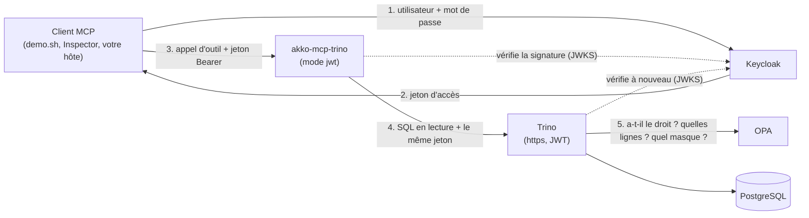

# akko-sandbox

**Deux comptes, une question, deux réponses.** Un bac à sable de cinq minutes pour
[akko-mcp-trino](https://github.com/AKKO-p/akko-mcp-trino), le serveur MCP open
source qui donne aux agents d'IA un accès en lecture seule à Trino, chaque
utilisateur avec ses propres droits.

[English](README.md)

Deux utilisateurs posent la même question par MCP. akko-mcp-trino vérifie le
jeton de chacun et le transmet à Trino. Trino le vérifie à son tour, exécute la
requête au nom de cet utilisateur et demande à une politique ce qu'il peut voir.
L'analyste obtient cinq clients européens aux adresses e-mail masquées ;
l'administratrice obtient les dix, en clair. Le serveur ne décide rien de tout cela.

```
3. Two answers, decided by the policy in Trino
   carol_analyst                                    alice_admin
   ----------------------------------------------   ----------------------------------------------
   Lena Vogel      ***@example.com             DE   Lena Vogel      lena.vogel@example.com      DE
   Hugo Martin     ***@example.com             FR   Hugo Martin     hugo.martin@example.com     FR
   Sofia Ruiz      ***@example.org             ES   Sofia Ruiz      sofia.ruiz@example.org      ES
   Giulia Conti    ***@example.org             IT   Noah Bennett    noah.bennett@example.com    US
   Emma de Vries   ***@example.org             NL   Giulia Conti    giulia.conti@example.org    IT
                                                    Kenji Sato      kenji.sato@example.com      JP
   ...
```

## Démarrer

Il faut Docker avec Compose v2, environ 2 Go de mémoire libre, et les ports
`8080`, `3000` et `6274` libres sur `localhost`.

```bash
git clone https://github.com/AKKO-p/akko-sandbox.git
cd akko-sandbox
docker compose up -d --wait
./demo.sh
```

Le premier démarrage télécharge les images (environ 1,7 Go sur disque). Ensuite,
le bac à sable est prêt en une minute environ. Pour tout arrêter et tout
supprimer : `docker compose down -v`.

## Ce que montre `demo.sh`

1. La même question SQL, envoyée par le client MCP officiel à l'outil `execute_query`.
2. `SELECT current_user` : Trino exécute chaque requête au nom de l'utilisateur dont il a reçu le jeton.
3. Les deux réponses côte à côte : e-mails masqués et filtre de lignes pour l'analyste, tout pour l'administratrice.
4. Un troisième utilisateur, `dave_viewer`, refusé par la politique.
5. Une requête sans jeton, puis une autre avec une signature falsifiée : les deux refusées par un `401`.

`./demo.sh --check` joue les mêmes étapes sous forme d'assertions.

## Utilisateurs

Des comptes de démonstration, avec un mot de passe de démonstration. Ne les
réutilisez jamais ailleurs.

| Utilisateur | Mot de passe | Voit |
|---|---|---|
| `alice_admin` | `demo` | toutes les lignes, toutes les colonnes en clair |
| `carol_analyst` | `demo` | les clients européens seulement, adresses e-mail masquées |
| `dave_viewer` | `demo` | tout sauf la table des clients |

La console Keycloak est sur <http://localhost:8080> (`admin` / `admin`).

## Ce qui tourne

| Service | Image | Rôle | Limite mémoire |
|---|---|---|---|
| `certs` | `alpine/openssl:3.5.9` | crée une autorité de certification de démonstration et le certificat de Trino, puis s'arrête | 32 Mo |
| `postgres` | `postgres:17.11-alpine` | les données fictives : clients, comptes, transactions | 128 Mo |
| `keycloak` | `quay.io/keycloak/keycloak:26.7.5` | le fournisseur d'identité, realm `sandbox` | 768 Mo |
| `opa` | `openpolicyagent/opa:1.21.1-static` | la politique d'accès, [`opa/policy.rego`](opa/policy.rego) | 64 Mo |
| `trino` | `trinodb/trino:482` | le moteur, en https, authentification JWT, contrôle d'accès OPA | 1280 Mo |
| `mcp` | `akkoai/akko-mcp-trino:0.5.3` | le serveur MCP, mode d'identité `jwt`, strict | 256 Mo |
| `inspector` | `ghcr.io/modelcontextprotocol/inspector:2.9.0` | l'Inspector MCP officiel | 384 Mo |

Mesuré sur un hôte Linux avec `docker stats` : entre 1,3 et 1,4 Go utilisés au
repos, environ 1,5 Go au plus fort de la démo. Trino et Keycloak en prennent l'essentiel.

Seuls Keycloak (`8080`), le serveur MCP (`3000`) et l'Inspector (`6274`) sont
publiés, et sur `127.0.0.1` seulement. `KEYCLOAK_PORT`, `MCP_PORT` et
`INSPECTOR_PORT` changent ces ports.

## Comment les pièces s'assemblent



- Le serveur MCP vérifie la signature du jeton, son émetteur (`http://localhost:8080/realms/sandbox`), son audience (`trino`) et son expiration, et refuse toute requête sans jeton.
- Il envoie ce même jeton à Trino, en https uniquement, en vérifiant le certificat de Trino avec l'autorité du bac à sable.
- Trino vérifie le jeton à son tour et exécute la requête au nom de son `preferred_username`.
- Trino interroge OPA avant chaque action. Toute la politique tient dans [un court fichier Rego](opa/policy.rego) : qui peut lire quoi, le masque des e-mails, le filtre de lignes.

Pour changer ce que voit un utilisateur, modifiez `opa/policy.rego` puis lancez
`docker compose restart opa`. Le serveur MCP ne change pas.

## Cliquer : l'Inspector MCP

1. Lisez l'adresse et le jeton d'accès de l'Inspector : `docker compose logs inspector | grep MCP_INSPECTOR_API_TOKEN`.
2. Ouvrez cette adresse. Choisissez le transport **Streamable HTTP** et l'URL `http://mcp:3000/mcp` (l'Inspector tourne dans le réseau du compose).
3. Obtenez un jeton avec `./token.sh carol_analyst` et ajoutez l'en-tête `Authorization: Bearer <jeton>`.
4. Connectez-vous, puis appelez `execute_query` avec `SELECT * FROM demo.crm.customers`. Recommencez avec le jeton d'alice.

## Brancher votre propre hôte MCP

Claude Desktop, Cursor, VS Code et Claude Code peuvent utiliser le serveur du
bac à sable, `http://localhost:3000/mcp`, avec le jeton d'un utilisateur. Voir
[docs/connect-a-host.fr.md](docs/connect-a-host.fr.md).

## Tester

```bash
tests/smoke.sh
```

Le test démarre le bac à sable sous son propre nom de projet, joue la démo,
vérifie les deux réponses différentes, `current_user`, chaque refus (à la porte
du serveur et chez Trino), la ligne d'audit et l'Inspector, affiche le temps de
démarrage et la mémoire, puis supprime tout. `KEEP=1` le laisse tourner.

## Pas pour la production

Tout ici est choisi pour démarrer en une commande sur un portable : un Keycloak
de développement en http, une connexion par mot de passe, un seul mot de passe
pour tous, une autorité de certification auto-signée, un secret partagé de
Trino fixe, une politique qui contient trois noms. L'image d'akko-mcp-trino et
sa configuration sont celles de la production ; le reste ne l'est pas.

## À propos d'AKKO

akko-mcp-trino est le cœur open source d'AKKO, un projet français qui construit
une plateforme de données souveraine avec une IA gouvernée. Voir
[akko-ai.com](https://akko-ai.com).

## Licence

[Apache 2.0](LICENSE).
