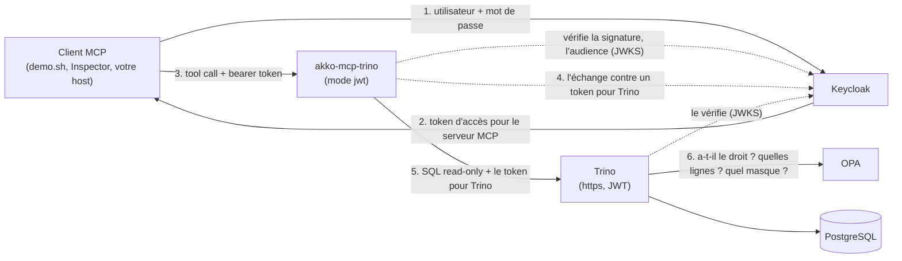

# akko-sandbox

[](https://github.com/AKKO-p/akko-sandbox/actions/workflows/smoke.yml)

<p align="center"></p>

**Deux comptes, une question, deux réponses.** Un sandbox de cinq minutes pour
[akko-mcp-trino](https://github.com/AKKO-p/akko-mcp-trino), le serveur MCP open
source qui donne aux agents d'IA un accès en lecture seule à Trino, chaque
utilisateur avec ses propres droits.

[English](README.md)

Deux utilisateurs posent la même question par MCP. akko-mcp-trino vérifie le
token de chacun, émis pour le serveur, et l'échange auprès de Keycloak contre un
token émis pour Trino : le token de l'utilisateur ne va jamais plus loin. Trino
vérifie ce token, exécute la requête au nom de cet utilisateur et demande à une
politique ce qu'il peut voir.
L'analyste obtient cinq clients européens aux adresses e-mail masquées ;
l'administratrice obtient les dix, en clair. Le serveur ne décide rien de tout cela.

## Démarrer

Il faut Docker avec Compose v2, environ 2 Go de mémoire libre, et les ports
`8080`, `3000` et `6274` libres sur `localhost`.

```bash
git clone https://github.com/AKKO-p/akko-sandbox.git
cd akko-sandbox
docker compose up -d --wait
./demo.sh
```

Le premier démarrage télécharge les images (environ 1,7 Go sur disque). Ensuite,
le sandbox est prêt en une minute environ. Pour tout arrêter et tout
supprimer : `docker compose down -v`.

## Ce que montre `demo.sh`

1. La même question SQL, envoyée par le client MCP officiel à l'outil `execute_query`.
2. `SELECT current_user` : Trino exécute chaque requête au nom de l'utilisateur dont il a reçu le token.
3. Les deux réponses côte à côte : e-mails masqués et filtre de lignes pour l'analyste, tout pour l'administratrice.
4. Un troisième utilisateur, `dave_viewer`, refusé par la politique.
5. Une écriture, refusée par le serveur avant d'atteindre Trino.
6. Une requête sans token, une autre avec une signature falsifiée, et une troisième avec un token valide mais émis pour Trino au lieu du serveur : les trois refusées par un `401`.

`./demo.sh --check` joue les mêmes étapes sous forme d'assertions.

## Utilisateurs

Des comptes de démonstration, avec un mot de passe de démonstration. Ne les
réutilisez jamais ailleurs.

| Utilisateur | Mot de passe | Voit |
|---|---|---|
| `alice_admin` | `demo` | toutes les lignes, toutes les colonnes en clair |
| `carol_analyst` | `demo` | les clients européens seulement, adresses e-mail masquées |
| `dave_viewer` | `demo` | tout sauf la table des clients et la colonne `balance` des comptes |

La console Keycloak est sur <http://localhost:8080> (`admin` / `admin`).

## Ce qui tourne

| Service | Image | Rôle | Limite mémoire |
|---|---|---|---|
| `certs` | `alpine/openssl:3.5.9` | crée une autorité de certification de démonstration, les certificats de Trino et de Keycloak et le secret client du serveur MCP, puis s'arrête | 32 Mo |
| `postgres` | `postgres:17.11-alpine` | les données fictives : clients, comptes, transactions, avec des commentaires sur les tables et les colonnes, et douze tables d'archive vides (`crm_archive`) | 128 Mo |
| `keycloak` | `quay.io/keycloak/keycloak:26.7.5` | le fournisseur d'identité, realm `sandbox`, avec le token exchange standard | 768 Mo |
| `opa` | `openpolicyagent/opa:1.21.1-static` | la politique d'accès, [`opa/policy.rego`](opa/policy.rego) | 64 Mo |
| `trino` | `trinodb/trino:482` | le moteur, en https, authentification JWT, contrôle d'accès OPA | 1280 Mo |
| `mcp` | `akkoai/akko-mcp-trino:0.6.0` | le serveur MCP, avec ses valeurs par défaut : mode d'identité `jwt` (token exchange), token valide exigé | 256 Mo |
| `inspector` | `ghcr.io/modelcontextprotocol/inspector:2.9.0` | l'Inspector MCP officiel | 384 Mo |

Mesuré sur une machine Linux avec `docker stats` : environ 1,3 Go utilisés au repos,
environ 1,5 Go au plus fort de la démo. Trino et Keycloak en prennent l'essentiel ;
le serveur MCP, environ 70 Mo.

Seuls Keycloak (`8080`), le serveur MCP (`3000`) et l'Inspector (`6274`) sont
publiés, et sur `127.0.0.1` seulement. `KEYCLOAK_PORT`, `MCP_PORT` et
`INSPECTOR_PORT` changent ces ports.

## Comment les pièces s'assemblent



- Le serveur MCP vérifie la signature du token, son issuer (`http://localhost:8080/realms/sandbox`), son audience (`akko-mcp`, le serveur lui-même) et son expiration, et refuse toute requête sans token valide. Un token émis pour Trino est refusé aussi.
- Il échange le token auprès de Keycloak, en https, contre un token dont l'audience est `trino` (OAuth 2.0 Token Exchange, RFC 8693), avec son propre client `akko-mcp`. Le token de l'utilisateur n'est jamais transmis.
- Il envoie ce token à Trino, en https uniquement, en vérifiant le certificat de Trino avec l'autorité du sandbox.
- Trino vérifie le token et exécute la requête au nom de son `preferred_username`.
- Trino interroge OPA avant chaque action. Toute la politique tient dans [un court fichier Rego](opa/policy.rego) : qui peut lire quoi, une colonne cachée, un catalogue caché, le masque des e-mails, le filtre de lignes, et personne n'agit sous le nom d'un autre utilisateur.

Pour changer ce que voit un utilisateur, modifiez `opa/policy.rego` puis lancez
`docker compose restart opa`. Le serveur MCP ne change pas.

## Cliquer : l'Inspector MCP

1. Ouvrez l'adresse affichée par l'Inspector : `docker compose logs inspector | grep MCP_INSPECTOR_API_TOKEN`.
2. **Add Servers**, puis **+ Add manually**. Donnez un identifiant, choisissez le transport `streamable-http` et l'URL `http://mcp:3000/mcp` (l'Inspector tourne dans le réseau du compose). Cliquez sur **Add**.
3. Récupérez un token avec `./token.sh carol_analyst`. Sur la carte du serveur, ouvrez **Settings**, puis **Custom Headers**, **+ Add Header** : `Authorization` et `Bearer <token>`. Fermez les réglages.
4. Passez la carte en **Connected**, puis appelez `execute_query` avec `SELECT * FROM demo.crm.customers`. Recommencez avec le token d'alice.

## Brancher votre propre host MCP

Claude Desktop, Cursor, VS Code et Claude Code peuvent utiliser le serveur du
sandbox, `http://localhost:3000/mcp`, avec le token d'un utilisateur. Voir
[docs/connect-a-host.fr.md](docs/connect-a-host.fr.md).

## Tester

```bash
tests/smoke.sh
```

Le test démarre le sandbox sous son propre nom de projet, joue la démo,
vérifie les deux réponses différentes, `current_user`, chaque refus (à la porte
du serveur et chez Trino), le token exchange, la ligne d'audit et l'Inspector,
affiche le temps de démarrage et la mémoire, puis supprime tout. `KEEP=1` le
laisse tourner. `MCP_IMAGE` lance une autre version du serveur, par exemple une
release candidate.

## Derrière Trino Gateway

Le même bac à sable peut tourner avec [Trino Gateway](https://trinodb.github.io/trino-gateway/)
devant deux clusters Trino. Le serveur MCP ne joint alors que le gateway : il
n'est pas sur le réseau des clusters, donc chaque requête, chaque page suivante
et chaque annulation passent par le gateway. Le gateway n'écoute qu'en https et
termine le TLS, et chaque cluster lit le protocole transmis
(`http-server.process-forwarded=true`). Sa propre API (backends, historique des
requêtes) demande son compte d'administration, dont le mot de passe est tiré au
hasard dans le volume `certs` et n'est pas lisible par le serveur MCP.

```bash
COMPOSE_FILE=compose.yaml:gateway/compose.gateway.yaml docker compose up -d --wait
COMPOSE_FILE=compose.yaml:gateway/compose.gateway.yaml ./demo.sh --check
COMPOSE_FILE=compose.yaml:gateway/compose.gateway.yaml docker compose --profile tools down -v
tests/gateway.sh   # les contrôles, de bout en bout
```

Démarrez la variante avec le même `COMPOSE_FILE` à chaque fois, et arrêtez-la
avec lui aussi : un `docker compose down` sans lui laisse derrière lui le second
cluster et le gateway.

`tests/gateway.sh` vérifie qu'un second démarrage est sain, les deux réponses
différentes à travers le gateway, que le serveur ne peut ni joindre un cluster
directement ni utiliser l'API d'administration du gateway, que le gateway refuse
les en-têtes de transfert envoyés par un client, que les requêtes se répartissent
sur les deux clusters et que chaque cluster les exécute au nom de l'utilisateur
qui a demandé, qu'un résultat plafonné passe par le gateway, qu'une requête qui
dépasse son délai est annulée dans Trino à travers le gateway, et que les refus
restent les mêmes. Il utilise les ports hôtes du bac à sable (8080, 3000, 6274) ;
pour le lancer à côté d'un bac à sable démarré, fixez les ports comme dans
l'en-tête du script. La CI le lance après `tests/smoke.sh`.

## Les outils d'akko-mcp-trino 0.7

```bash
MCP_IMAGE=<image 0.7> tests/v07.sh
GATEWAY=1 MCP_IMAGE=<image 0.7> tests/v07.sh   # les mêmes contrôles derrière Trino Gateway
```

`tests/v07.sh` vérifie les outils qu'akko-mcp-trino 0.7 ajoute ou change, sur le
bac à sable complété par [`tests/compose.v07.yaml`](tests/compose.v07.yaml) (des
pages de cinq noms, des pages de `describe_schema` de quatre tables et dix
colonnes au plus, et deux catalogues de plus pris dans
[`tests/v07/catalog`](tests/v07/catalog), `tpch` et `tpcds`, générés par Trino,
le second caché aux viewers par la politique ; avec `GATEWAY=1`,
[`tests/compose.v07.gateway.yaml`](tests/compose.v07.gateway.yaml) les donne
aussi au second cluster) : `search_columns` trouve `transactions.amount` par le mot
`revenue` de son commentaire ; `dave_viewer` n'obtient rien de `crm.customers`,
de la colonne `balance` des comptes ni du catalogue `tpcds`, par aucun outil,
messages d'erreur compris, tant qu'il ne les nomme pas lui-même (voir plus bas),
alors que carol ou alice obtiennent chacun d'eux ; sa recherche dans tous les
catalogues fouille chaque schéma de `demo` et de `tpch` ; Trino lui-même retire
la colonne de `information_schema.columns`, de `system.jdbc.columns`, de
`SHOW COLUMNS`, de `DESCRIBE` et de `SELECT *` pour lui ; `list_tables` et
`describe_schema` parcourent `crm_archive` page par page, chaque table une fois
et entière ; une recherche avec un budget d'appel court dit ce qu'elle n'a pas
fouillé, et son curseur la reprend jusqu'au bout ; les erreurs portent leur `kind`, Trino arrêté compris ; une politique qui
refuse `system.jdbc` reçoit une erreur qui dit quoi autoriser ; le SQL de l'agent
sur `system` reste refusé et n'atteint jamais le moteur ; le journal du serveur
contient une ligne d'audit pour chaque appel et aucun token. Le script
affiche aussi les plans des requêtes de métadonnées de `describe_schema`.
`V07_SHORT_BUDGET` et `V07_SHORT_RESERVE` (3 et 2 secondes) fixent le budget
court. L'image par défaut reste la 0.6.0, sur laquelle ces contrôles échouent :
la CI lancera le script une fois la 0.7 publiée.

La politique cache la colonne `balance` aux viewers par deux opérations du
plugin OPA de Trino : `FilterColumns` la retire de chaque listing, et
`SelectFromColumns` refuse une requête qui la nomme. Le bac à sable fixe
`opa.policy.batched-uri` : Trino pose `FilterColumns` une fois par listing, à la
règle `batch` de la politique, qui applique `allow` à chaque colonne ; sans ce
réglage, Trino interroge OPA une colonne à la fois, et une table de 200 colonnes
sature sa file. Trino tourne avec `hide-inaccessible-columns=true`, que nous
conseillons aussi aux administrateurs : `SELECT *` répond alors sans la colonne
cachée. Sans ce réglage, `SELECT *` est refusé, et en Trino 482 ce refus liste
toutes les colonnes de la table, la colonne cachée comprise : c'est le message de
Trino, que le serveur transmet entier. Une requête qui nomme la colonne reste
refusée ; les contrôles lisent le code d'erreur, pas le texte. De même, un
catalogue qu'il nomme reçoit le refus de Trino (`Cannot access catalog tpcds`,
kind `permission`) là où un catalogue absent reçoit `not found` (kind
`catalog`) : Trino distingue les deux.

## Un agent réel : combien d'appels jusqu'à la bonne colonne

[`agent/`](agent/README.md) pose à un vrai modèle (Mistral ou Anthropic, par leurs
API) cinq questions sur les données d'exemple, par MCP, en tant que
`carol_analyst`, et compte les appels d'outils jusqu'à la réponse finale, l'appel
où une colonne attendue apparaît pour la première fois, les jetons, et si la
réponse nomme les bonnes colonnes. Lancés contre deux images du serveur avec le
même modèle et les mêmes réglages, les rapports se comparent ligne à ligne.
`--dry-run` liste les outils sans modèle ni clé.

## Pas pour la production

Tout ici est choisi pour démarrer en une commande sur un portable : un Keycloak
de développement (http pour le navigateur, https pour le token exchange), une
connexion par mot de passe, un seul mot de passe pour tous, une autorité de
certification auto-signée, un secret client rangé dans un volume partagé, un
secret partagé de Trino fixe, une politique qui contient trois noms. Derrière le
gateway, chaque cluster fait confiance à `X-Forwarded-Proto` venant de n'importe
quel pair de son réseau : en production, seul le gateway doit joindre un cluster. Le gateway est lancé par `java -jar` et
le chemin du jar dans son image, qu'une montée de version peut déplacer. Son mot
de passe d'administration et sa clé de session sont lisibles par tous les
services qui tournent en uid 1000 (Keycloak, Trino, le gateway), seul le serveur
MCP ne peut pas les lire. L'image d'akko-mcp-trino et
sa configuration sont celles de la production ; le reste ne l'est pas.

## À propos d'AKKO

akko-mcp-trino est le cœur open source d'AKKO, un projet français qui construit
une plateforme de données souveraine avec une IA gouvernée. Voir
[akko-ai.com](https://akko-ai.com).

## Licence

[Apache 2.0](LICENSE).
