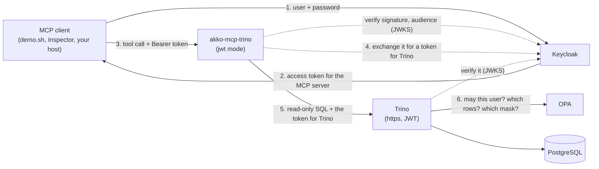

# akko-sandbox

[](https://github.com/AKKO-p/akko-sandbox/actions/workflows/smoke.yml)

<p align="center"></p>

**Two accounts, one question, two answers.** A five minute sandbox for
[akko-mcp-trino](https://github.com/AKKO-p/akko-mcp-trino), the open source MCP
server that gives AI agents read-only access to Trino, each user with their own rights.

[Français](README.fr.md)

Two users ask the same question through MCP. akko-mcp-trino verifies each
user's token, issued for the server, and exchanges it at Keycloak for a token
issued for Trino: the user's own token never goes further. Trino verifies that
token, runs the query as that user, and asks a policy what they may see. The analyst gets five European
customers with masked e-mail addresses; the admin gets all ten, in clear. The
server decides none of it.

## Start

You need Docker with Compose v2, about 2 GB of free memory, and the ports
`8080`, `3000` and `6274` free on `localhost`.

```bash
git clone https://github.com/AKKO-p/akko-sandbox.git
cd akko-sandbox
docker compose up -d --wait
./demo.sh
```

The first start downloads the images (about 1.7 GB on disk). After that, the sandbox is
ready in about a minute. Stop it and remove everything with
`docker compose down -v`.

## What `demo.sh` shows

1. The same SQL question, sent by the official MCP client to the `execute_query` tool.
2. `SELECT current_user`: Trino runs each query as the user whose token it received.
3. The two answers side by side: masked e-mails and a row filter for the analyst, everything for the admin.
4. A third user, `dave_viewer`, refused by the policy.
5. A write, refused by the server before it reaches Trino.
6. A request without a token, one with a forged signature, and one with a valid token issued for Trino instead of the server: all three refused with `401`.

`./demo.sh --check` plays the same steps as assertions.

## Users

Demo accounts, with a demo password. Never reuse them anywhere.

| User | Password | Sees |
|---|---|---|
| `alice_admin` | `demo` | every row, every column in clear |
| `carol_analyst` | `demo` | European customers only, e-mail addresses masked |
| `dave_viewer` | `demo` | everything except the customers table and the accounts' `balance` column |

The Keycloak console is at <http://localhost:8080> (`admin` / `admin`).

## What runs

| Service | Image | Role | Memory limit |
|---|---|---|---|
| `certs` | `alpine/openssl:3.5.9` | creates a demo certificate authority, Trino's and Keycloak's certificates and the MCP server's client secret, then exits | 32 MB |
| `postgres` | `postgres:17.11-alpine` | the fictional sample data: customers, accounts, transactions, with comments on tables and columns, and twelve empty archive tables (`crm_archive`) | 128 MB |
| `keycloak` | `quay.io/keycloak/keycloak:26.7.5` | the identity provider, realm `sandbox`, with standard token exchange | 768 MB |
| `opa` | `openpolicyagent/opa:1.21.1-static` | the access policy, [`opa/policy.rego`](opa/policy.rego) | 64 MB |
| `trino` | `trinodb/trino:482` | the engine, https, JWT authentication, OPA access control | 1280 MB |
| `mcp` | `akkoai/akko-mcp-trino:0.6.0` | the MCP server, with its defaults: identity mode `jwt` (token exchange), a valid token required | 256 MB |
| `inspector` | `ghcr.io/modelcontextprotocol/inspector:2.9.0` | the official MCP Inspector | 384 MB |

Measured on a Linux host with `docker stats`: about 1.3 GB in use at rest, about
1.5 GB at the peak of the demo. Trino and Keycloak use most of it; the MCP server
about 70 MB.

Only Keycloak (`8080`), the MCP server (`3000`) and the Inspector (`6274`) are
published, on `127.0.0.1` only. Set `KEYCLOAK_PORT`, `MCP_PORT` or
`INSPECTOR_PORT` to use other ports.

## How the pieces fit



- The MCP server verifies the token's signature, issuer (`http://localhost:8080/realms/sandbox`), audience (`akko-mcp`, the server itself) and expiry, and refuses a request without a valid one. A token issued for Trino is refused too.
- It exchanges the token at Keycloak, over https, for a token whose audience is `trino` (OAuth 2.0 Token Exchange, RFC 8693), with its own client `akko-mcp`. The user's token is never passed on.
- It sends that token to Trino over https only, checking Trino's certificate against the sandbox CA.
- Trino verifies the token and runs the query as its `preferred_username`.
- Trino asks OPA before every action. The whole policy is [one short Rego file](opa/policy.rego): who may read what, a hidden column, a hidden catalog, the e-mail mask, the row filter, and nobody acting under another user's name.

To change what a user sees, edit `opa/policy.rego` and run
`docker compose restart opa`. The MCP server needs no change.

## Click through it: the MCP Inspector

1. Open the address the Inspector prints: `docker compose logs inspector | grep MCP_INSPECTOR_API_TOKEN`.
2. **Add Servers**, then **+ Add manually**. Give it an ID, choose the transport `streamable-http` and the URL `http://mcp:3000/mcp` (the Inspector runs in the compose network). Click **Add**.
3. Get a token with `./token.sh carol_analyst`. On the new server card, open **Settings**, then **Custom Headers**, **+ Add Header**: `Authorization` and `Bearer <token>`. Close the settings.
4. Switch the card to **Connected**, then call `execute_query` with `SELECT * FROM demo.crm.customers`. Do it again with alice's token.

## Connect your own MCP host

Claude Desktop, Cursor, VS Code and Claude Code can use the sandbox's server at
`http://localhost:3000/mcp` with a user's token. See
[docs/connect-a-host.md](docs/connect-a-host.md).

## Test

```bash
tests/smoke.sh
```

It starts the sandbox under its own project name, plays the demo, checks the
two different answers, `current_user`, every refusal (the server's door and
Trino's own), the token exchange, the audit line and the Inspector, prints the
start time and the memory, and removes everything. `KEEP=1` leaves it running.
`MCP_IMAGE` runs another build of the server, such as a release candidate.

## Behind Trino Gateway

The same sandbox can run with [Trino Gateway](https://trinodb.github.io/trino-gateway/)
in front of two Trino clusters. The MCP server then reaches the gateway only:
it is not on the clusters' network, so every request, every next page and every
cancel goes through the gateway. The gateway listens on https only and
terminates TLS, and each cluster reads the forwarded protocol
(`http-server.process-forwarded=true`). Its own API (backends, query history)
asks for its admin account, whose password is drawn at random in the `certs`
volume and is not readable by the MCP server.

```bash
COMPOSE_FILE=compose.yaml:gateway/compose.gateway.yaml docker compose up -d --wait
COMPOSE_FILE=compose.yaml:gateway/compose.gateway.yaml ./demo.sh --check
COMPOSE_FILE=compose.yaml:gateway/compose.gateway.yaml docker compose --profile tools down -v
tests/gateway.sh   # the checks, end to end
```

Start the variant with the same `COMPOSE_FILE` every time, and stop it with it
too: a `docker compose down` without it leaves the second cluster and the
gateway behind.

`tests/gateway.sh` checks that a second start is healthy, the two different
answers through the gateway, that the server can neither reach a cluster
directly nor use the gateway's admin API, that the gateway refuses forwarded
headers sent by a client, that queries spread over both clusters and that each
cluster runs them as the user who asked, that a capped result goes through the
gateway, that a query past its time budget is cancelled in Trino through the
gateway, and that the refusals stay the same. It uses the sandbox's host ports
(8080, 3000, 6274); to run it next to a running sandbox, set the ports as in the
script's header. The CI runs it after `tests/smoke.sh`.

## The tools of akko-mcp-trino 0.7

```bash
MCP_IMAGE=<0.7 image> tests/v07.sh
GATEWAY=1 MCP_IMAGE=<0.7 image> tests/v07.sh   # the same checks behind Trino Gateway
```

`tests/v07.sh` checks the tools that akko-mcp-trino 0.7 adds or changes, on the
sandbox with [`tests/compose.v07.yaml`](tests/compose.v07.yaml) on top (pages of
five names, `describe_schema` pages of four tables and ten columns at most, and
two more catalogs from [`tests/v07/catalog`](tests/v07/catalog), `tpch` and
`tpcds`, generated by Trino, the second hidden from viewers by the policy; with
`GATEWAY=1`, [`tests/compose.v07.gateway.yaml`](tests/compose.v07.gateway.yaml)
gives them to the second cluster too):
`search_columns` finds `transactions.amount` by the word `revenue` of its
comment; `dave_viewer` gets nothing of `crm.customers`, of the accounts'
`balance` column or of the `tpcds` catalog, from any tool, error messages
included, as long as he does not name them himself (see below), while carol or
alice get each of them; his search of every catalog searches every schema of
`demo` and `tpch`; Trino itself leaves the column out of
`information_schema.columns`, `system.jdbc.columns`, `SHOW COLUMNS`, `DESCRIBE`
and `SELECT *` for him; `list_tables` and
`describe_schema` walk `crm_archive` page by page, every table once and whole; a
search with a short call budget says what it did not search, and its cursor
resumes it to the end; errors carry their `kind`, Trino stopped included; a
policy that refuses `system.jdbc` gets an error that says what to allow; the
agent's own SQL on `system` stays refused and never reaches the engine; the
server's log holds an audit line for every call and no token. It also
prints the plans of `describe_schema`'s metadata statements. `V07_SHORT_BUDGET`
and `V07_SHORT_RESERVE` (3 and 2 seconds) set the short budget. The default
image is still 0.6.0, on which these checks fail: the CI runs the script once
0.7 is published.

The policy hides the `balance` column from viewers with two operations of
Trino's OPA plugin: `FilterColumns` leaves it out of every listing, and
`SelectFromColumns` refuses a query that names it. The sandbox sets
`opa.policy.batched-uri`, so Trino asks `FilterColumns` once per listing, at the
policy's `batch` rule, which applies `allow` to each column; without it Trino
asks OPA one column at a time, and a table of 200 columns saturates OPA's queue. Trino runs with `hide-inaccessible-columns=true`, which we advise
administrators to set too: `SELECT *` then answers without the hidden column.
Without it, `SELECT *` is refused, and in Trino 482 that refusal lists every
column of the table, the hidden one included: Trino's message, which the server
passes on whole. A query that names the column is still refused; the checks
read the error code, not the text. In the same way, a catalog he names gets
Trino's refusal (`Cannot access catalog tpcds`, kind `permission`) where a
missing one gets `not found` (kind `catalog`): Trino tells the two apart.

## A real agent: how many calls to the right column

[`agent/`](agent/README.md) asks a real model (Mistral or Anthropic, by their
APIs) five questions about the sample data, through MCP, as `carol_analyst`, and
counts the tool calls until the final answer, the call at which an expected
column first shows, the tokens, and whether the answer names the right columns.
Run against two server images with the same model and settings, the reports
compare line by line. `--dry-run` lists the tools without any model or key.

## Not for production

Everything here is chosen to start in one command on a laptop: a development
Keycloak (http for the browser, https for the token exchange), a password grant,
one password for every user, a self-signed certificate authority, a client
secret kept in a shared volume, a fixed Trino shared secret, a policy with
three names in it. Behind the gateway, each cluster trusts `X-Forwarded-Proto`
from any peer on its network: in production, nothing but the gateway should
reach a cluster. The gateway is started with `java -jar` and the jar's path
inside its image, which an image bump may move. Its admin password and session
key are readable by every service that runs as uid 1000 (Keycloak, Trino, the
gateway), only not by the MCP server. The akko-mcp-trino image and its configuration are the same as in
production; the rest is not.

## About AKKO

akko-mcp-trino is the open source core of AKKO, a French project building a
sovereign data platform with governed AI. See [akko-ai.com](https://akko-ai.com).

## License

[Apache 2.0](LICENSE).
