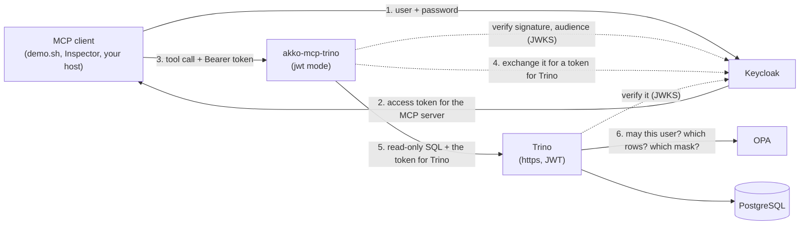

# akko-sandbox

[](https://github.com/AKKO-p/akko-sandbox/actions/workflows/smoke.yml)

<p align="center"></p>

**Three accounts, one question, three outcomes.** A five minute sandbox for
[akko-mcp-trino](https://github.com/AKKO-p/akko-mcp-trino), the open source MCP
server that gives AI agents read-only access to Trino, each user with their own rights.

[Français](README.fr.md)

Two users ask the same question through MCP. akko-mcp-trino verifies each
user's token, issued for the server, and exchanges it at Keycloak for a token
issued for Trino: the user's own token never goes further. Trino verifies that
token, runs the query as that user, and asks a policy what they may see. The analyst gets five European
customers with masked e-mail addresses; the admin gets all ten, in clear. The
server decides none of it.

## Start

You need Docker with Compose v2, about 2.5 GB of free memory, and the ports
`8080`, `3000` and `6274` free on `localhost`.

```bash
git clone https://github.com/AKKO-p/akko-sandbox.git
cd akko-sandbox
docker compose up -d --wait
./demo.sh
```

The first start downloads the images (about 1.7 GB on disk). After that, the sandbox is
ready in about a minute. Stop it and remove everything with
`docker compose down -v`.

## What `demo.sh` shows

1. The same SQL question, sent by the official MCP client to the `execute_query` tool.
2. `SELECT current_user`: Trino runs each query as the user whose token it received.
3. The two answers side by side: masked e-mails and a row filter for the analyst, everything for the admin.
4. A third user, `dave_viewer`, refused by the policy.
5. The same column search for carol and dave (`search_columns`, from akko-mcp-trino 0.7): the word `email` finds `demo.crm.customers.email` for carol, and nothing for dave, from whom the policy hides the table. His search is complete all the same: nothing was skipped, the table is simply not his to see.
6. A write, refused by the server before it reaches Trino.
7. A request without a token, one with a forged signature, and one with a valid token issued for Trino instead of the server: all three refused with `401`.

`./demo.sh --check` plays the same steps as assertions.

## Users

Demo accounts, with a demo password. Never reuse them anywhere.

| User | Password | Sees |
|---|---|---|
| `alice_admin` | `demo` | every row, every column in clear |
| `carol_analyst` | `demo` | European customers only, e-mail addresses masked |
| `dave_viewer` | `demo` | everything except the customers table and the accounts' `balance` column |

The Keycloak console is at <http://localhost:8080> (`admin` / `admin`).

## What runs

| Service | Image | Role | Memory limit |
|---|---|---|---|
| `certs` | `alpine/openssl:3.5.9` | creates a demo certificate authority, Trino's and Keycloak's certificates and the MCP server's client secret, then exits | 32 MB |
| `postgres` | `postgres:17.11-alpine` | the fictional sample data: customers, accounts, transactions, with comments on tables and columns, and twelve empty archive tables (`crm_archive`) | 128 MB |
| `keycloak` | `quay.io/keycloak/keycloak:26.7.5` | the identity provider, realm `sandbox`, with standard token exchange | 768 MB |
| `opa` | `openpolicyagent/opa:1.21.1-static` | the access policy, [`opa/policy.rego`](opa/policy.rego) | 64 MB |
| `trino` | `trinodb/trino:482` | the engine, https, JWT authentication, OPA access control | 2048 MB |
| `mcp` | `akkoai/akko-mcp-trino:0.8.0` | the MCP server, with its defaults: identity mode `jwt` (token exchange), a valid token required | 384 MB |
| `inspector` | `ghcr.io/modelcontextprotocol/inspector:2.9.0` | the official MCP Inspector | 384 MB |

Measured on a Linux host with `docker stats`: about 1.4 GB in use at rest
(1460 MiB), about 1.7 GB at the peak of the demo (1740 MiB). Trino and Keycloak
use most of it (970 and 550 MiB at the peak); the MCP server about 75 MiB.

Trino runs with `MALLOC_ARENA_MAX=2` and 2048 MB. The searches of
`search_columns` and `describe_schema` ask it many metadata queries; with
1280 MB its off-heap memory outgrows the limit and the kernel kills it. glibc
gives each thread its own malloc arena, and with Trino's many threads they add
about 0.5 GB; two arenas take that back.

Only Keycloak (`8080`), the MCP server (`3000`) and the Inspector (`6274`) are
published, on `127.0.0.1` only. Set `KEYCLOAK_PORT`, `MCP_PORT` or
`INSPECTOR_PORT` to use other ports.

## How the pieces fit



- The MCP server verifies the token's signature, issuer (`http://localhost:8080/realms/sandbox`), audience (`akko-mcp`, the server itself) and expiry, and refuses a request without a valid one. A token issued for Trino is refused too.
- It exchanges the token at Keycloak, over https, for a token whose audience is `trino` (OAuth 2.0 Token Exchange, RFC 8693), with its own client `akko-mcp`. The user's token is never passed on.
- It sends that token to Trino over https only, checking Trino's certificate against the sandbox CA.
- Trino verifies the token and runs the query as its `preferred_username`.
- Trino asks OPA before every action. The whole policy is [one short Rego file](opa/policy.rego): who may read what, a hidden column, a hidden catalog, the e-mail mask, the row filter, and nobody acting under another user's name.

To change what a user sees, edit `opa/policy.rego` and run
`docker compose restart opa`. The MCP server needs no change.

## Click through it: the MCP Inspector

1. Open the address the Inspector prints: `docker compose logs inspector | grep MCP_INSPECTOR_API_TOKEN`.
2. **Add Servers**, then **+ Add manually**. Give it an ID, choose the transport `streamable-http` and the URL `http://mcp:3000/mcp` (the Inspector runs in the compose network). Click **Add**.
3. Get a token with `./token.sh carol_analyst`. On the new server card, open **Settings**, then **Custom Headers**, **+ Add Header**: `Authorization` and `Bearer <token>`. Close the settings.
4. Switch the card to **Connected**, then call `execute_query` with `SELECT * FROM demo.crm.customers`. Do it again with alice's token.

## Connect your own MCP host

Claude Desktop, Cursor, VS Code and Claude Code can use the sandbox's server at
`http://localhost:3000/mcp` with a user's token. See
[docs/connect-a-host.md](docs/connect-a-host.md).

## Test

```bash
tests/smoke.sh
```

It starts the sandbox under its own project name, plays the demo, checks the
two different answers, `current_user`, every refusal (the server's door and
Trino's own), the token exchange (in Keycloak's own event log), the audit line
and the Inspector, prints the start time and the memory, and removes everything.
`KEEP=1` leaves it running. `MCP_IMAGE` runs another build of the server, such as
a release candidate.

## Behind Trino Gateway

The same sandbox can run with [Trino Gateway](https://trinodb.github.io/trino-gateway/)
in front of two Trino clusters. The MCP server then reaches the gateway only:
it is not on the clusters' network, so every request, every next page and every
cancel goes through the gateway. The gateway listens on https only and
terminates TLS, and each cluster reads the forwarded protocol
(`http-server.process-forwarded=true`). Its own API (backends, query history)
asks for its admin account, whose password is drawn at random in the `certs`
volume and is not readable by the MCP server.

```bash
COMPOSE_FILE=compose.yaml:gateway/compose.gateway.yaml docker compose up -d --wait
COMPOSE_FILE=compose.yaml:gateway/compose.gateway.yaml ./demo.sh --check
COMPOSE_FILE=compose.yaml:gateway/compose.gateway.yaml docker compose --profile tools down -v
tests/gateway.sh   # the checks, end to end
```

This variant runs two Trino of 2048 MB each. Measured with `docker stats`, it
reaches 3058 MiB at the peak of `tests/gateway.sh` and 3220 MiB during the 0.7
checks: plan for about 4 GB of free memory.

Start the variant with the same `COMPOSE_FILE` every time, and stop it with it
too: a `docker compose down` without it leaves the second cluster and the
gateway behind.

`tests/gateway.sh` checks that a second start is healthy, the two different
answers through the gateway, that the server can neither reach a cluster
directly nor use the gateway's admin API, that the gateway refuses forwarded
headers sent by a client, that queries spread over both clusters and that each
cluster runs them as the user who asked, that a capped result goes through the
gateway, that a query past its time budget is canceled in Trino through the
gateway, and that the refusals stay the same. It uses the sandbox's host ports
(8080, 3000, 6274); to run it next to a running sandbox, set the ports as in the
script's header. The CI runs it after `tests/smoke.sh`.

## The nine tools of akko-mcp-trino 0.8

| Tool | What it does |
|---|---|
| `list_catalogs` | lists the catalogs the caller sees |
| `list_schemas` | lists the schemas of a catalog, in pages |
| `list_tables` | lists the tables of a schema, in pages |
| `describe_schema` | describes a schema: its tables and their columns, with the context from a data catalog when one is configured |
| `describe_table` | describes a table: columns, types, comments, with the same context |
| `search_columns` | finds columns and tables by the words of their names and comments |
| `profile_table` | summarizes a table's columns |
| `execute_query` | runs a read query as the caller |
| `explain_query` | checks a query without running it |

`demo.sh --check` requires exactly these nine tools, for every user.

## The tools of akko-mcp-trino 0.7

```bash
tests/v07.sh
GATEWAY=1 tests/v07.sh   # the same checks behind Trino Gateway
```

`tests/v07.sh` checks the tools that akko-mcp-trino 0.7 adds or changes, on the
sandbox with [`tests/compose.v07.yaml`](tests/compose.v07.yaml) on top (pages of
five names, `describe_schema` pages of four tables and ten columns at most, and
two more catalogs from [`tests/v07/catalog`](tests/v07/catalog), `tpch` and
`tpcds`, generated by Trino, the second hidden from viewers by the policy; with
`GATEWAY=1`, [`tests/compose.v07.gateway.yaml`](tests/compose.v07.gateway.yaml)
gives them to the second cluster too):
`search_columns` finds `transactions.amount` by the word `revenue` of its
comment, and searches by words: every word must appear in a column's name or
comment or its table's, a table found by its own name or comment comes in
`tables` without its columns, a word found only in a table's comment returns
that table alone, an empty complete search carries a `hint`, and a text of more
words than the server's limit is refused before any query; `dave_viewer` gets nothing of `crm.customers`, of the accounts'
`balance` column or of the `tpcds` catalog, from any tool, error messages
included, as long as he does not name them himself (see below), while carol or
alice get each of them; his search of every catalog searches every schema of
`demo` and `tpch`; Trino itself leaves the column out of
`information_schema.columns`, `system.jdbc.columns`, `SHOW COLUMNS`, `DESCRIBE`
and `SELECT *` for him; `list_tables` and
`describe_schema` walk `crm_archive` page by page, every table once and whole; a
search with a short call budget says what it did not search, and its cursor
resumes it to the end; errors carry their `kind`, Trino stopped included; a
policy that refuses `system.jdbc` gets an error that says what to allow; the
agent's own SQL on `system` stays refused and never reaches the engine; the
server's log holds an audit line for every call and no token. It also
prints the plans of `describe_schema`'s metadata statements. `V07_SHORT_BUDGET`
and `V07_SHORT_RESERVE` (3 and 2 seconds) set the short budget. The CI runs
the script after `tests/gateway.sh`.

The policy hides the `balance` column from viewers with two operations of
Trino's OPA plugin: `FilterColumns` leaves it out of every listing, and
`SelectFromColumns` refuses a query that names it. The sandbox sets
`opa.policy.batched-uri`, so Trino asks `FilterColumns` once per listing, at the
policy's `batch` rule, which applies `allow` to each column; without it Trino
asks OPA one column at a time, and a table of 200 columns saturates OPA's
queue. The masks are batched the same way (`opa.policy.batch-column-masking-uri`
and the `batchColumnMasks` rule). Trino runs with `hide-inaccessible-columns=true`,
which we advise administrators to set too: `SELECT *` then answers without the hidden column.
Without it, `SELECT *` is refused, and in Trino 482 that refusal lists every
column of the table, the hidden one included: Trino's message, which the server
passes on whole. A query that names the column is still refused; the checks
read the error code, not the text. In the same way, a catalog he names gets
Trino's refusal (`Cannot access catalog tpcds`, kind `permission`) where a
missing one gets `not found` (kind `catalog`): Trino tells the two apart.

## Context from a data catalog: Apache Atlas

```bash
COMPOSE_FILE=compose.yaml:catalogs/compose.atlas.yaml COMPOSE_PROFILES=catalogs \
  docker compose up -d --wait
tests/context.sh
GATEWAY=1 tests/context.sh   # behind Trino Gateway
```

akko-mcp-trino 0.8 reads a data catalog and adds its context to `describe_table`
and `describe_schema`. It serves that context only for the tables and columns
that Trino shows the caller. The `catalogs` profile
([`catalogs/compose.atlas.yaml`](catalogs/compose.atlas.yaml)) adds Apache Atlas
2.4.0 and turns on the server's Atlas provider.

Atlas is opt-in: the default `docker compose up` does not start it. The default
image, `akkoai/akko-mcp-trino:0.8.0`, includes the Atlas provider. It stays
inactive until `MCP_CONTEXT_PROVIDERS` lists it, which the `catalogs` profile
does.

Apache Atlas publishes source releases only.
[`catalogs/atlas/Dockerfile`](catalogs/atlas/Dockerfile) builds the server from
the official source release. The build checks it against the SHA-512 that the
Apache Software Foundation (ASF) publishes next to it. HBase 2.5.0 and Solr
8.11.3, the versions this release is built against, come from the ASF archive,
each checked against its SHA-512. The first start builds the image. On a machine
with 16 processors, the Maven build took 7 min 18 s. The image is 2.98 GB. Atlas
has no data volume: removing its container deletes the catalog, and the seed
writes it again on the next start.

[`catalogs/seed.py`](catalogs/seed.py) writes the demo catalog through Atlas's
REST API v2, as the `admin` user:

- a data steward's description of each table and column in `crm`;
- the glossary `Sales`, with five terms, each with a status: `Customer`
  (attached to `crm.customers` only), `Account`, `Revenue`, `Turnover` (a synonym
  of `Revenue`) and `Opening date`;
- the glossary `Compliance`, with the term `Personal data`, attached to columns
  that every user can see;
- a renamed table, a deleted table and a deleted column;
- a table under the Atlas cluster `tpch`, which no Trino catalog maps to.

The server reads Atlas as `mcp_reader`, a user with Atlas's built-in read-only
role `DATA_SCIENTIST`. Its password is generated at random and stored in the
`atlas-secrets` volume. Trino's `demo` catalog maps to the Atlas cluster
`sandbox`. Only the glossary `Sales` is served.

The profile adds its own rules to the policy, in
[`catalogs/policy.rego`](catalogs/policy.rego), which OPA loads only when
`catalogs/compose.atlas.yaml` is in `COMPOSE_FILE`, as in this profile's
commands. The sandbox's default policy stays the one the other checks were
measured with. The first rule hides `accounts.opened_on` from analysts. The
second filters salary payments out of their transactions. The third hides the
canary `demo.mcp.canary` from everyone, admins included. Before it serves
context, the server checks that Trino still hides the canary from the caller. If
the caller can see it, the visibility filter cannot be trusted, and the server
serves no context.

Here is what Carol gets for the `amount` column of `crm.transactions`, copied
from a run of `tests/context.sh`. The `Compliance` term attached to the same
column is absent.

```json
{
  "column_context": {
    "amount": {
      "description": "Amount of the movement, in the account's currency",
      "sources": {"description": "atlas"},
      "terms": [{"name": "Revenue", "ref": "t2"}]
    }
  },
  "terms": {
    "t1": {"name": "Turnover", "glossary": "Sales", "definition": "Total revenue over a period",
           "status": "draft", "related": [{"ref": "t2", "name": "Revenue", "relation": "synonym"}],
           "source": "atlas"},
    "t2": {"name": "Revenue", "glossary": "Sales", "definition": "Money that comes in from a sale",
           "status": "approved", "related": [{"ref": "t1", "name": "Turnover", "relation": "synonym"}],
           "source": "atlas"}
  },
  "context_sources": {"atlas": "ok", "file": "ok"}
}
```

`tests/context.sh` adds [`tests/compose.v08.yaml`](tests/compose.v08.yaml): a
second provider, `file`, which declares the grain and the joins of two tables,
two notions Atlas lacks; the `fingerprint-audit` module; a context deadline of 3
seconds; an Atlas read timeout of 30 seconds, so that only that deadline can end
a slow read in time; and no cache, so that each call reads Atlas and Trino
again. It checks the following:

- Carol gets the descriptions, the terms of `Sales` and their status, in
  `describe_table` and `describe_schema`;
- Dave gets nothing about `crm.customers`. The table is absent from his answers,
  from his audit lines, and from his query history on each cluster, which the
  check reads as the admin user. Atlas's own log shows no read of the table
  during his calls. OPA's decision log names the table for Dave in one place
  only: Trino's own listing filter, which refused it. Trino has to send the table
  to OPA to filter his listing. Only the visibility filter's queries carry the
  client tag `mcp-gate`. `system.runtime.queries` has no client tags column, so
  the check reads the tags from the coordinator's `/v1/query` endpoint;
- the column the policy hides from Carol, `accounts.opened_on`, is absent from
  the context, the grain and the joins, and its term is not named. This column
  was chosen because no earlier check and no question in `agent/` uses it. The
  term attached only to `crm.customers` never appears in the context of another
  table. No `Compliance` term appears;
- the renamed table returns `not_found`, the `tpch` catalog returns
  `not_mapped`, and the deleted table and column are never served;
- `profile_table` on the masked `email`, and on `amount` under the row filter,
  returns the same `rows`, `min` and `max` as `execute_query` for the same user;
- a policy that makes the canary visible returns `not_checked`, and the server
  logs one warning per call that names no user and no table;
- with Atlas stopped, the Atlas source reports `unavailable`, and the call still
  returns. With Atlas paused past the deadline, the source reports `unavailable`.
  The call takes no longer than the same call with Atlas healthy, plus the
  deadline, plus the 0.25 s the server waits past it and the 0.5 s reply margin
  of the provider contract. akko-mcp-trino closes the pool connection that
  carried the request, that very one, before Atlas reads it: while Atlas is
  still frozen, the server's socket is gone, or in FIN_WAIT2 with no process
  holding it. HTTP cannot withdraw a request already sent: the data catalog may
  still read and answer it, and that answer reaches no one. Once Atlas is
  resumed, it no longer holds that connection, and the server has no socket left
  for it, so Atlas's answer finds no reader. Before the pause, the same probe
  must find the server's pooled connection from both ends: that positive
  check shows the probe sees what is there;
- when Atlas rejects the account, the server tries one login, then none until
  the secret file changes. It logs `atlas refused the account` once. Atlas
  itself does not log failed logins. With `ATLAS_LOG_REFUSED_LOGINS=true`, set
  only by `tests/compose.v08.yaml`,
  [`catalogs/atlas/start.sh`](catalogs/atlas/start.sh) writes them to
  `/data/logs/logins.log`, without passwords. That file uses the Log4j 2 core
  that Atlas 2.4.0 ships, version 2.17.2.

Whatever happens, the end of a run removes the allow-all policy of the canary
check, resumes or starts Atlas and puts the reader's secret back, with `KEEP=1`
and after Ctrl-C too, and it names each restore it made.
[`tests/interrupt.sh`](tests/interrupt.sh) replays that: it interrupts
`tests/context.sh` as Ctrl-C does, at five points, and reads the state from
outside.

Tested with Apache Atlas 2.4.0 built by
[`catalogs/atlas/Dockerfile`](catalogs/atlas/Dockerfile), `trinodb/trino:482`,
`trinodb/trino-gateway:22`, `quay.io/keycloak/keycloak:26.7.5`,
`openpolicyagent/opa:1.21.1-static`, `postgres:17.11-alpine`, and akko-mcp-trino
built from commit `4bd78f2`. That commit closes the connection of a context read
that hits its deadline. Without the
gateway, all 104 checks passed. Here is the section on a slow Atlas:

```text
== 8. A slow Atlas: the call answers in time, and Atlas's late answer finds no reader
  OK    carol, describe_table transactions with Atlas healthy: atlas ok
  OK    the probe sees the server's pooled connection to Atlas from both ends, held by the server
  describe_table answered in 3.75 s with Atlas frozen, 1.27 s with Atlas healthy; the context deadline is 3 s
  OK    carol, describe_table transactions with Atlas frozen: atlas unavailable, file ok
  OK      the columns and the file's grain still come
  OK      the call took at least the deadline, 3 s, end to end
  OK      and no longer: at most the deadline + 0.25 s + 0.5 s more than with Atlas healthy
  OK    Atlas's side: one connection holds the request unread, and the client closed it (CLOSE_WAIT)
  OK      it is a connection of the pool, open before the pause
  OK      the server no longer holds it: its socket is gone, or in FIN_WAIT2 with no process
  Atlas, resumed, served: GET http://atlas:21000/api/atlas/v2/entity/bulk/uniqueAttribute/type/hive_table?attr_0%3AqualifiedName=crm.transactions%40sandbox, status 200
  OK    Atlas resumed: it no longer holds the connection of the cut read
  OK      and the server has no socket for it: Atlas's answer finds no reader
  OK    Atlas back: the context comes again
```

Here the client is akko-mcp-trino, seen from Atlas. Built from commit `0e0159c`,
before that fix, an earlier form of the check on the closed connection failed
with `got closed by the client 0, open with a request unread 1`. Atlas, resumed, still reads and
answers the request it had received; that answer reaches no one. Its audit log
shows that answer, which the script prints.

Behind the gateway (`GATEWAY=1`), all 104 checks passed as well, and
`describe_table` with Atlas paused answered in 3.92 s. The check
reads the query history on both clusters.

Memory at rest without the gateway, measured with `docker stats` right after
startup: Atlas 1.934 GiB (limit 3 GiB), Trino 812.4 MiB, Keycloak 547.5 MiB, the
MCP server 90.68 MiB, the Inspector 113.2 MiB, PostgreSQL 36.27 MiB, OPA 11.98 MiB.
Plan for about 4 GB of free memory. Startup took 318 s, mostly for Atlas.

Behind the gateway, `docker stats` measured at rest: Atlas 1.922 GiB, the two Trino
clusters 742.8 MiB and 778.3 MiB, Keycloak 495.9 MiB, the gateway 346.5 MiB, the
MCP server 81.54 MiB. Plan for about 5 GB of free memory.

## Context at scale: 2,000 columns, 50,000 terms

```bash
tests/load.sh
```

`tests/load.sh` checks that the context holds on a large data catalog. It also
measures its cost. It adds [`tests/compose.load.yaml`](tests/compose.load.yaml)
to the `catalogs` profile. PostgreSQL allows 1,600 columns at most, so the wide
tables are in a second Trino catalog, `wide`, on Trino's memory connector. The
server maps it to the same Atlas cluster, `sandbox`, and serves the glossary
`Generated` next to `Sales`.

[`tests/load/seed.py`](tests/load/seed.py) writes three things into Atlas:

- three tables, `load.wide_2000`, `load.wide_2000_2` and `load.wide_2000_3`,
  each with 2,000 columns, each column with a description;
- the glossary `Generated`, with 50,000 terms, in requests of 500;
- 2,000 of these terms for each table, attached to its columns, one term per
  column.

Atlas has a bulk call for glossary terms, `POST /api/atlas/v2/glossary/terms`.
It checks each new name against every term of the glossary, so each request
takes longer as the glossary grows. In an earlier run with Atlas 2.4.0, the
first 500 terms took 15.1 s, and the 500 after the first 25,000 took 211.6 s.
The seed writes the terms through the entity bulk call,
`POST /api/atlas/v2/entity/bulk`, as `AtlasGlossaryTerm` entities anchored to
the glossary. Atlas then serves them like any other term.

The run sets the caches' lifetime to 60 s, the table cache to 64 MiB
(`MCP_CONTEXT_CACHE_BYTES=67108864`) and the terms cache to 16 MiB
(`MCP_CONTEXT_TERMS_CACHE_BYTES=16777216`). The visibility cache keeps its
default, 32 MiB. The script reads the three limits back from the server's
`--check`. The server's container may use 1 GiB, above the bound checked below,
so that a server past it is measured, not killed. The sandbox gives it 384 MiB:
the burst peaked at 254.8 MiB, at the edge of the 256 MiB it had before.

The run has four steps:

1. The server starts with its default time budgets, 5 s, and its caches empty.
   Carol calls `describe_table` on `wide_2000` four times in a row. The script
   prints what each call served, and how long Atlas took for each read of the
   table.
2. The server starts again with the run's settings. Carol calls
   `describe_table` once, to fill the caches.
3. After the caches expired, the script sends 50 calls at once, each from its
   own MCP session.
4. The server starts again with small cache limits: 512 KiB for tables,
   256 KiB for terms, and a lifetime of 600 s, so that nothing expires. Carol
   calls `describe_table` on the three tables in turn. One table fits its
   cache alone, two do not. The terms of one table already overflow theirs.

After the 50 calls, the script checks the following:

- the server's memory stays under its three cache limits plus 256 MiB,
  measured by `docker stats` during the burst and by its cgroup's peak since
  it started. The caches hold far less than their limits here, so this bound
  is an envelope; step 4 checks the limits themselves;
- Atlas reads the table once and each of the 2,000 terms once for the whole
  burst. The script counts the reads in Atlas's own audit log, between two
  markers it writes there;
- more calls than the 32 read slots sent that read or waited on it. The script
  counts them from the server's cache lookups: each call looks up the table
  and its 2,000 terms once, and a call that finds the table cached is a hit
  for all of them. In this run, 40 calls sent the read or waited on it, and
  10 were served from the cache;
- every answer keeps its context under `MCP_CONTEXT_RESPONSE_CHARS` (60,000),
  says `"context_truncated": true`, lists the columns left out in
  `undescribed_columns`, and gives the source as `partial`.

The server gives a source as `partial` for any of three reasons: it cut the
context to `MCP_CONTEXT_RESPONSE_CHARS` (`"context_truncated": true`), the page
of `describe_table` did not list every column of the table (`TRINO_MAX_ROWS`
below the number of columns), or part of the source's read failed, the table or
its terms (a call past its deadline, as in step 1). In the burst, the page lists
all 2,000 columns, and the source is `partial` because the context is cut.

The script also prints how many calls have a window, from their request to
their answer, that overlaps Atlas's read of the table, and checks that at
least 45 of the 50 do. A window counts the call's whole time, Trino's
`DESCRIBE` included, so a call served from the cache can overlap the read too.

With the small limits, the script checks that the caches stay under them after
each call. `wide_2000_3`, read last, is still cached: Atlas does not read it
again. `wide_2000`, read first, was evicted: Atlas reads it again. Atlas also
reads its 2,000 terms again; the terms of one table alone overflow their
cache, so this shows that cache overflowing. The server's memory stays under
the new bound.

Each check can be made to fail. These witness runs use the project of a run
kept with `KEEP=1`, and stop after the burst (`LOAD_BURST_ONLY=1`). The first
five ran on `d61d669`, the build before `e60f915`, with the same settings; the
last one on `e60f915`:

| Variables | What it shows |
|---|---|
| `LOAD_CACHE_BYTES=1 LOAD_TERMS_CACHE_BYTES=1` | No cache, 50 calls at once. Atlas read the table twice, not 50 times. By their end times, 40 calls shared the first read, and 10 calls reached the context after it ended and read the table again. The check of one read fails. |
| the same, with `LOAD_CALLS=5 LOAD_SPREAD_SECONDS=15` | No cache, 5 calls 15 s apart. Atlas read the table once per call, and the window of 1 of the 5 calls overlapped the first read. Both checks fail. |
| `LOAD_MEMORY_MARGIN_MB=0 LOAD_RESPONSE_LIMIT=50000` | The script's bounds are below what was measured: the memory checks and the check of the response limit fail. |
| `LOAD_RESPONSE_CHARS=30000` | The server's own limit is lower. Every context is 29,760 characters and still cut. Every check passes. |
| `LOAD_OPA_MEMORY=64m` | OPA has the sandbox's 64 MiB. The burst passed, and the kernel did not kill OPA. |
| `LOAD_MAX_ROWS=100` | `TRINO_MAX_ROWS` at its default. The answer lists 100 columns, all described, with a context of 33,808 characters, not cut. The source is still `partial`: the page lists 100 of the 2,000 columns. The checks of 2,000 columns, of the cut and of 2,000 terms fail. |

The run raises four settings, as the server's docs advise for large data
catalogs. The first three have a reason measured on these builds:

- `TRINO_MAX_ROWS` is 2000, so one page of `describe_table` lists every column
  of a wide table, and the context is read and cut for all 2,000 columns. With
  the default, 100, the answer listed 100 columns, and their context fit whole
  (the last witness run above).
- `ATLAS_TIMEOUT_SECONDS` is 20 s. It bounds one request, and Atlas's read of
  the table took 6.3 to 9.4 s with the server's caches empty, over six runs on
  `d61d669` and `e60f915`. With the default, 5 s, the first of four calls in a
  row served no context (`unavailable`), and the next three a part of it
  (`partial`).
- `MCP_CONTEXT_TIMEOUT_SECONDS` is 40 s. It bounds the read of the table and
  then of its 2,000 terms. On `d61d669`, at 20 s, in one burst, Atlas took
  11.2 s for the table and 15 s for its terms: 39 of the 50 answers came back
  without terms.
- OPA gets 512 MiB. An earlier build saw the kernel kill OPA at the sandbox's
  64 MiB during the burst, and Trino then failed every statement. On
  `d61d669`, the burst passed with 64 MiB (a witness run above). The run keeps
  512 MiB as a margin: this reason was not measured on these builds.

`MCP_CONTEXT_MAX_CONCURRENCY` keeps its default, 32. In the burst, 40 calls
sent the one read of the table or waited on it, and 10 were served from the
cache. A call that waits takes none of the 32 slots: none of the 50 answers
reported `unavailable`.

The run used a machine with 16 processors and 62.8 GiB of memory, and these
images: akko-mcp-trino built from commit `e60f915` (version 0.8.0), Apache
Atlas 2.4.0 built by [`catalogs/atlas/Dockerfile`](catalogs/atlas/Dockerfile),
`trinodb/trino:482`, `openpolicyagent/opa:1.21.1-static`,
`quay.io/keycloak/keycloak:26.7.5` and `postgres:17.11-alpine`. All 43 checks
passed. Here is an excerpt of its output:

```text
  seed: terms: 50000 in 743.2 s, 500 a request (67 a second)
  seed: columns: wide_2000, 2000 in 56.7 s, 500 a request
  seed: attached: wide_2000, 2000 terms, one a column, in 59.0 s
  ...
== 3. The server's default time budgets, with its caches empty
  context: atlas (timeout 5 s; atlas: timeouts: connect 1 s, read 5 s
  call 1: 6.38 s, atlas unavailable
  call 2: 5.53 s, atlas partial
  call 3: 5.43 s, atlas partial
  call 4: 3.83 s, atlas partial
  Atlas's reads of wide_2000, by its audit log: 8.53 s, 3.95 s
  ...
== 4. One call, which fills the caches
  describe_table answered in 15.02 s, caches empty; Atlas read the table in 7.10 s
  OK    carol, describe_table wide_2000: 2000 columns, the context of Atlas, cut
  OK      each column described or listed as undescribed, once
  OK      each column described carries its description and its own term of Generated
  176 columns described, 1824 undescribed, 176 terms, context of 59724 characters
  the server's caches hold 735938 bytes (mcp_trino_context_cache_bytes)
== 5. 50 calls of describe_table at once, after the caches expired
  ...
  the burst took 27.28 s; each call 22.11 s to 27.27 s; the calls started within 0.01 s
  the server's cache lookups during the burst: 80040 misses, 20010 hits, 2001 a call
  40 calls waited on the read in flight or sent it, 10 served from the cache
  OK      more calls met the read in flight than there are read slots: 40 > 32
  OK    50 answers, none an error
  the source of the context, answers by status: {'partial': 50}
  the server's memory: at most 226.8 MiB in 17 samples of docker stats; cgroup peak since start 254.8 MiB; bound 368.0 MiB (the three caches + 256 MiB)
  OK      docker stats sampled it, at least 5 times
  OK    the server's memory stayed under the bound, by docker stats
  OK      and by its cgroup's peak since it started
  OK      the server was neither restarted nor killed
  OK    no service was killed for lack of memory
  OK    Atlas read the table once for the whole burst (its audit log)
  OK      and each of the 2000 terms once: reads, distinct terms
  OK      and nothing else
  Atlas's read of the table: from 4.17 s to 12.05 s after the first call started; the windows of 50 of the 50 calls overlap it
  OK      the windows of at least 45 of the 50 calls overlap that read (90 %)
  the context of each answer: 59724 to 59724 characters, limit 60000
  OK    every context under the limit
  OK      and every answer says it was cut, its source partial
  OK      and the same context in each
  ...
== 7. Small cache limits, overflowed by the three tables
  MCP_CONTEXT_CACHE_BYTES=524288 MCP_CONTEXT_TERMS_CACHE_BYTES=262144 MCP_CONTEXT_TTL_SECONDS=600
  OK    the server runs with the small limits
  wide_2000: 14.20 s, atlas partial; the caches hold 579078 bytes
  wide_2000_2: 14.52 s, atlas partial; the caches hold 579125 bytes
  wide_2000_3: 13.97 s, atlas partial; the caches hold 579125 bytes
  OK    the caches held at most their two limits, 786432 bytes, after each call
  OK    wide_2000_3, read last, is still cached: Atlas does not read it again
  OK    wide_2000, read first, was evicted: Atlas reads it again
  and its terms: 2000 reads, 2000 distinct terms
  OK      and its terms too, all 2000
  the server's memory: at most 106.8 MiB in 34 samples of docker stats; cgroup peak since start 150.1 MiB; bound 288.8 MiB (the three caches + 256 MiB)
  OK      docker stats sampled it, at least 5 times
  OK    the server's memory stayed under the bound, by docker stats
  OK      and by its cgroup's peak since it started
  OK      the server was neither restarted nor killed
```

The script also counts the statements each tool runs in Trino, as Carol, on the
wide table. It reads them from Trino's own history, `system.runtime.queries`,
and the client tags from `/v1/query`, 1 s after the answer. Each tool is called
once with the caches expired, then once more right after. The visibility
filter's statements carry the tag `mcp-gate`, and all come from the source
`trino-mcp`.

| Tool | Caches expired | Right after |
|---|---|---|
| `describe_table` | 3 (2 `mcp-gate`) | 1 (0 `mcp-gate`) |
| `describe_schema` | 8 (2 `mcp-gate`) | 6 (0 `mcp-gate`) |
| `search_columns` | 5 (0 `mcp-gate`) | 5 (0 `mcp-gate`) |
| `profile_table` | 2 (0 `mcp-gate`) | 2 (0 `mcp-gate`) |

The seed took 1,088 s, after a startup of 320 s. The host had 7.9 GiB of memory
available before the seed and 6.9 GiB before the burst. Atlas keeps the
sandbox's sizing, a heap of 768 MiB in a container of 3 GiB.

## A real agent: how many calls to the right column

[`agent/`](agent/README.md) asks a real model (Mistral or Anthropic, by their
APIs) five questions about the sample data, through MCP, as `carol_analyst`, and
counts the tool calls until the final answer, the call at which an expected
column first shows, the tokens, and whether the answer names the right columns.
Run against two server images with the same model and settings, the reports
compare line by line. `--dry-run` lists the tools without any model or key.

## The bench: dated results and a regression gate

[`bench/`](bench/README.md) plays these checks under one entry point,
`bench/run.sh <axis>`, after a preflight that refuses a host without the memory
for it. Each run writes a dated result in `bench/results/`, every check under a
stable id, with the images by digest, the host's state and each suite's memory
peak, and holds it against the baseline of its pair (server version, model): a
check that passed and fails now, or one not run, fails the run. It also holds the
marker scanner that looks for hidden names in every channel a viewer reaches, the
k6 script checked against the MCP Inspector, and the agent harness's Wilson
interval.

## Not for production

Everything here is chosen to start in one command on a laptop: a development
Keycloak (http for the browser, https for the token exchange), a password grant,
one password for every user, a self-signed certificate authority, a client
secret kept in a shared volume, a fixed Trino shared secret, a policy with
three names in it. Behind the gateway, each cluster trusts `X-Forwarded-Proto`
from any peer on its network: in production, nothing but the gateway should
reach a cluster. The gateway is started with `java -jar` and the jar's path
inside its image, which an image bump may move. Its admin password and session
key are readable by every service that runs as uid 1000 (Keycloak, Trino, the
gateway), only not by the MCP server. With the `catalogs` profile, Atlas
runs without TLS. Its users are defined in a file, and HBase and Solr run inside
the Atlas container.
The akko-mcp-trino image and its configuration are the same as in
production; the rest is not.

## About AKKO

akko-mcp-trino is the open source core of AKKO, a French project building a
sovereign data platform with governed AI. See [akko-ai.com](https://akko-ai.com).

## License

[Apache 2.0](LICENSE).
