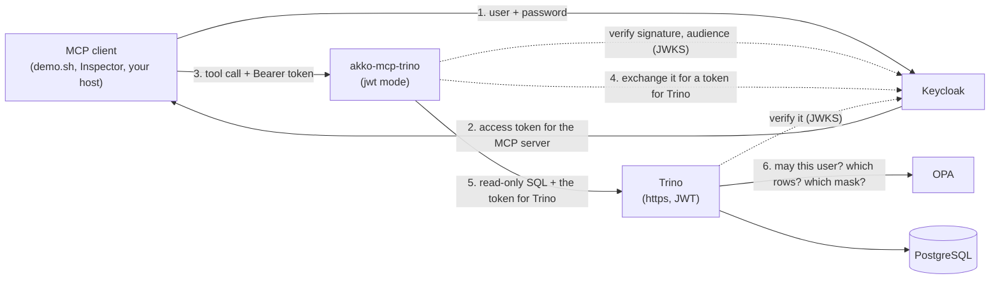

# akko-sandbox

[](https://github.com/AKKO-p/akko-sandbox/actions/workflows/smoke.yml)

<p align="center"></p>

**Three accounts, one question, three outcomes.** A five minute sandbox for
[akko-mcp-trino](https://github.com/AKKO-p/akko-mcp-trino), the open source MCP
server that gives AI agents read-only access to Trino, each user with their own rights.

[Français](README.fr.md)

Two users ask the same question through MCP. akko-mcp-trino verifies each
user's token, issued for the server, and exchanges it at Keycloak for a token
issued for Trino: the user's own token never goes further. Trino verifies that
token, runs the query as that user, and asks a policy what they may see. The analyst gets five European
customers with masked e-mail addresses; the admin gets all ten, in clear. The
server decides none of it.

## Start

You need Docker with Compose v2, about 2.5 GB of free memory, and the ports
`8080`, `3000` and `6274` free on `localhost`.

```bash
git clone https://github.com/AKKO-p/akko-sandbox.git
cd akko-sandbox
docker compose up -d --wait
./demo.sh
```

The first start downloads the images (about 1.7 GB on disk). After that, the sandbox is
ready in about a minute. Stop it and remove everything with
`docker compose down -v`.

## What `demo.sh` shows

1. The same SQL question, sent by the official MCP client to the `execute_query` tool.
2. `SELECT current_user`: Trino runs each query as the user whose token it received.
3. The two answers side by side: masked e-mails and a row filter for the analyst, everything for the admin.
4. A third user, `dave_viewer`, refused by the policy.
5. The same column search for carol and dave (`search_columns`, from akko-mcp-trino 0.7): the word `email` finds `demo.crm.customers.email` for carol, and nothing for dave, from whom the policy hides the table. His search is complete all the same: nothing was skipped, the table is simply not his to see.
6. A write, refused by the server before it reaches Trino.
7. A request without a token, one with a forged signature, and one with a valid token issued for Trino instead of the server: all three refused with `401`.

`./demo.sh --check` plays the same steps as assertions.

## Users

Demo accounts, with a demo password. Never reuse them anywhere.

| User | Password | Sees |
|---|---|---|
| `alice_admin` | `demo` | every row, every column in clear |
| `carol_analyst` | `demo` | European customers only, e-mail addresses masked; no salary payments among the transactions, no account opening date |
| `dave_viewer` | `demo` | everything except the customers table and the accounts' `balance` column |

The Keycloak console is at <http://localhost:8080> (`admin` / `admin`).

## What runs

| Service | Image | Role | Memory limit |
|---|---|---|---|
| `certs` | `alpine/openssl:3.5.9` | creates a demo certificate authority, Trino's and Keycloak's certificates and the MCP server's client secret, then exits | 32 MB |
| `postgres` | `postgres:17.11-alpine` | the fictional sample data: customers, accounts, transactions, with comments on tables and columns, and twelve empty archive tables (`crm_archive`) | 128 MB |
| `keycloak` | `quay.io/keycloak/keycloak:26.7.5` | the identity provider, realm `sandbox`, with standard token exchange | 768 MB |
| `opa` | `openpolicyagent/opa:1.21.1-static` | the access policy, [`opa/policy.rego`](opa/policy.rego) | 64 MB |
| `trino` | `trinodb/trino:482` | the engine, https, JWT authentication, OPA access control | 2048 MB |
| `mcp` | `akkoai/akko-mcp-trino:0.7.2` | the MCP server, with its defaults: identity mode `jwt` (token exchange), a valid token required | 256 MB |
| `inspector` | `ghcr.io/modelcontextprotocol/inspector:2.9.0` | the official MCP Inspector | 384 MB |

Measured on a Linux host with `docker stats`: about 1.4 GB in use at rest
(1460 MiB), about 1.7 GB at the peak of the demo (1740 MiB). Trino and Keycloak
use most of it (970 and 550 MiB at the peak); the MCP server about 75 MiB.

Trino runs with `MALLOC_ARENA_MAX=2` and 2048 MB. The searches of
`search_columns` and `describe_schema` ask it many metadata queries; with
1280 MB its off-heap memory outgrows the limit and the kernel kills it. glibc
gives each thread its own malloc arena, and with Trino's many threads they add
about 0.5 GB; two arenas take that back.

Only Keycloak (`8080`), the MCP server (`3000`) and the Inspector (`6274`) are
published, on `127.0.0.1` only. Set `KEYCLOAK_PORT`, `MCP_PORT` or
`INSPECTOR_PORT` to use other ports.

## How the pieces fit



- The MCP server verifies the token's signature, issuer (`http://localhost:8080/realms/sandbox`), audience (`akko-mcp`, the server itself) and expiry, and refuses a request without a valid one. A token issued for Trino is refused too.
- It exchanges the token at Keycloak, over https, for a token whose audience is `trino` (OAuth 2.0 Token Exchange, RFC 8693), with its own client `akko-mcp`. The user's token is never passed on.
- It sends that token to Trino over https only, checking Trino's certificate against the sandbox CA.
- Trino verifies the token and runs the query as its `preferred_username`.
- Trino asks OPA before every action. The whole policy is [one short Rego file](opa/policy.rego): who may read what, two hidden columns, a hidden catalog, a canary table hidden from everyone, the e-mail mask, two row filters, and nobody acting under another user's name.

To change what a user sees, edit `opa/policy.rego` and run
`docker compose restart opa`. The MCP server needs no change.

## Click through it: the MCP Inspector

1. Open the address the Inspector prints: `docker compose logs inspector | grep MCP_INSPECTOR_API_TOKEN`.
2. **Add Servers**, then **+ Add manually**. Give it an ID, choose the transport `streamable-http` and the URL `http://mcp:3000/mcp` (the Inspector runs in the compose network). Click **Add**.
3. Get a token with `./token.sh carol_analyst`. On the new server card, open **Settings**, then **Custom Headers**, **+ Add Header**: `Authorization` and `Bearer <token>`. Close the settings.
4. Switch the card to **Connected**, then call `execute_query` with `SELECT * FROM demo.crm.customers`. Do it again with alice's token.

## Connect your own MCP host

Claude Desktop, Cursor, VS Code and Claude Code can use the sandbox's server at
`http://localhost:3000/mcp` with a user's token. See
[docs/connect-a-host.md](docs/connect-a-host.md).

## Test

```bash
tests/smoke.sh
```

It starts the sandbox under its own project name, plays the demo, checks the
two different answers, `current_user`, every refusal (the server's door and
Trino's own), the token exchange (from Keycloak's own events), the audit line and the Inspector, prints the
start time and the memory, and removes everything. `KEEP=1` leaves it running.
`MCP_IMAGE` runs another build of the server, such as a release candidate.

## Behind Trino Gateway

The same sandbox can run with [Trino Gateway](https://trinodb.github.io/trino-gateway/)
in front of two Trino clusters. The MCP server then reaches the gateway only:
it is not on the clusters' network, so every request, every next page and every
cancel goes through the gateway. The gateway listens on https only and
terminates TLS, and each cluster reads the forwarded protocol
(`http-server.process-forwarded=true`). Its own API (backends, query history)
asks for its admin account, whose password is drawn at random in the `certs`
volume and is not readable by the MCP server.

```bash
COMPOSE_FILE=compose.yaml:gateway/compose.gateway.yaml docker compose up -d --wait
COMPOSE_FILE=compose.yaml:gateway/compose.gateway.yaml ./demo.sh --check
COMPOSE_FILE=compose.yaml:gateway/compose.gateway.yaml docker compose --profile tools down -v
tests/gateway.sh   # the checks, end to end
```

This variant runs two Trino of 2048 MB each. Measured with `docker stats`, it
reaches 3058 MiB at the peak of `tests/gateway.sh` and 3220 MiB during the 0.7
checks: plan for about 4 GB of free memory.

Start the variant with the same `COMPOSE_FILE` every time, and stop it with it
too: a `docker compose down` without it leaves the second cluster and the
gateway behind.

`tests/gateway.sh` checks that a second start is healthy, the two different
answers through the gateway, that the server can neither reach a cluster
directly nor use the gateway's admin API, that the gateway refuses forwarded
headers sent by a client, that queries spread over both clusters and that each
cluster runs them as the user who asked, that a capped result goes through the
gateway, that a query past its time budget is cancelled in Trino through the
gateway, and that the refusals stay the same. It uses the sandbox's host ports
(8080, 3000, 6274); to run it next to a running sandbox, set the ports as in the
script's header. The CI runs it after `tests/smoke.sh`.

## The tools of akko-mcp-trino 0.7

```bash
tests/v07.sh
GATEWAY=1 tests/v07.sh   # the same checks behind Trino Gateway
```

`tests/v07.sh` checks the tools that akko-mcp-trino 0.7 adds or changes, on the
sandbox with [`tests/compose.v07.yaml`](tests/compose.v07.yaml) on top (pages of
five names, `describe_schema` pages of four tables and ten columns at most, and
two more catalogs from [`tests/v07/catalog`](tests/v07/catalog), `tpch` and
`tpcds`, generated by Trino, the second hidden from viewers by the policy; with
`GATEWAY=1`, [`tests/compose.v07.gateway.yaml`](tests/compose.v07.gateway.yaml)
gives them to the second cluster too):
`search_columns` finds `transactions.amount` by the word `revenue` of its
comment, and searches by words: every word must appear in a column's name or
comment or its table's, a table found by its own name or comment comes in
`tables` without its columns, a word found only in a table's comment returns
that table alone, an empty complete search carries a `hint`, and a text of more
words than the server's limit is refused before any query; `dave_viewer` gets nothing of `crm.customers`, of the accounts'
`balance` column or of the `tpcds` catalog, from any tool, error messages
included, as long as he does not name them himself (see below), while carol or
alice get each of them; his search of every catalog searches every schema of
`demo` and `tpch`; Trino itself leaves the column out of
`information_schema.columns`, `system.jdbc.columns`, `SHOW COLUMNS`, `DESCRIBE`
and `SELECT *` for him; `list_tables` and
`describe_schema` walk `crm_archive` page by page, every table once and whole; a
search with a short call budget says what it did not search, and its cursor
resumes it to the end; errors carry their `kind`, Trino stopped included; a
policy that refuses `system.jdbc` gets an error that says what to allow; the
agent's own SQL on `system` stays refused and never reaches the engine; the
server's log holds an audit line for every call and no token. It also
prints the plans of `describe_schema`'s metadata statements. `V07_SHORT_BUDGET`
and `V07_SHORT_RESERVE` (3 and 2 seconds) set the short budget. The CI runs
the script after `tests/gateway.sh`.

The policy hides the `balance` column from viewers with two operations of
Trino's OPA plugin: `FilterColumns` leaves it out of every listing, and
`SelectFromColumns` refuses a query that names it. The sandbox sets
`opa.policy.batched-uri`, so Trino asks `FilterColumns` once per listing, at the
policy's `batch` rule, which applies `allow` to each column; without it Trino
asks OPA one column at a time, and a table of 200 columns saturates OPA's
queue. The masks are batched the same way (`opa.policy.batch-column-masking-uri`
and the `batchColumnMasks` rule). Trino runs with `hide-inaccessible-columns=true`,
which we advise administrators to set too: `SELECT *` then answers without the hidden column.
Without it, `SELECT *` is refused, and in Trino 482 that refusal lists every
column of the table, the hidden one included: Trino's message, which the server
passes on whole. A query that names the column is still refused; the checks
read the error code, not the text. In the same way, a catalog he names gets
Trino's refusal (`Cannot access catalog tpcds`, kind `permission`) where a
missing one gets `not found` (kind `catalog`): Trino tells the two apart.

## Context from a data catalog: Apache Atlas

```bash
COMPOSE_FILE=compose.yaml:catalogs/compose.atlas.yaml COMPOSE_PROFILES=catalogs \
  MCP_IMAGE=<an image of akko-mcp-trino 0.8> docker compose up -d --wait
MCP_IMAGE=<an image of akko-mcp-trino 0.8> tests/context.sh
MCP_IMAGE=<an image of akko-mcp-trino 0.8> GATEWAY=1 tests/context.sh   # behind Trino Gateway
```

akko-mcp-trino 0.8 reads a data catalog and adds its context to `describe_table`
and `describe_schema`. It serves that context only for the tables and columns
Trino lists to the caller. The profile `catalogs`
([`catalogs/compose.atlas.yaml`](catalogs/compose.atlas.yaml)) adds Apache Atlas
2.4.0 and turns on the server's Atlas provider.

0.8 is not on Docker Hub yet. Until it is, build the image from the `main` branch
of akko-mcp-trino and pass it in `MCP_IMAGE`. The Atlas provider comes with the
image, inactive until `MCP_CONTEXT_PROVIDERS` names it.

Apache Atlas publishes its sources only.
[`catalogs/atlas/Dockerfile`](catalogs/atlas/Dockerfile) builds the server from
the official source release, checked against the SHA-512 that the Apache Software
Foundation publishes next to it. HBase 2.5.0 and Solr 8.11.3, the versions the
release names, come from the ASF archive, each checked against its SHA-512. The
first start builds the image: the Maven build took 7 min 18 s on a 16-core
machine, and the image takes 2.98 GB. Atlas keeps its state inside its
container.

[`catalogs/seed.py`](catalogs/seed.py) writes the demo catalog through Atlas's
REST API v2, as admin:

- a steward's description for each crm table and column;
- the glossary `Sales`, with five terms, each with a status: `Customer`, attached
  to `crm.customers` only, `Account`, `Revenue`, its synonym `Turnover`, and
  `Opening date`;
- the glossary `Compliance`, with the term `Personal data`, attached to columns
  every user sees;
- a renamed table, a deleted table and a deleted column;
- a table under the Atlas cluster `tpch`, which no Trino catalog maps to.

The server reads Atlas with `mcp_reader`, an account of Atlas's own role
`DATA_SCIENTIST`, which may only read. Its password is drawn at random in the
`atlas-secrets` volume. Trino's catalog `demo` is Atlas's cluster `sandbox`. Only
the glossary `Sales` is served. The canary `demo.mcp.canary` is a table the
policy hides from everyone, admins included: the server serves context to a
caller only while Trino hides it from them.

Here is what `carol_analyst` gets for the column `amount` of
`crm.transactions`, copied from a run of `tests/context.sh`. The term of
`Compliance`, attached to the same column, is not there:

```json
{
  "column_context": {
    "amount": {
      "description": "Amount of the movement, in the account's currency",
      "sources": {"description": "atlas"},
      "terms": [{"name": "Revenue", "ref": "t2"}]
    }
  },
  "terms": {
    "t1": {"name": "Turnover", "glossary": "Sales", "definition": "The revenue of a period, added up",
           "status": "draft", "related": [{"ref": "t2", "name": "Revenue", "relation": "synonym"}],
           "source": "atlas"},
    "t2": {"name": "Revenue", "glossary": "Sales", "definition": "Money that comes in from a sale",
           "status": "approved", "related": [{"ref": "t1", "name": "Turnover", "relation": "synonym"}],
           "source": "atlas"}
  },
  "context_sources": {"atlas": "ok", "file": "ok"}
}
```

`tests/context.sh` adds [`tests/compose.v08.yaml`](tests/compose.v08.yaml): a
second provider, `file`, which gives two tables a grain and joins, since Atlas has
no notion of either; the module `fingerprint-audit`; a context deadline of 3
seconds; and no cache, so that each call reads Atlas and Trino again. It checks:

- `carol_analyst` gets the descriptions, the terms of `Sales` and their status,
  in `describe_table` and `describe_schema`;
- `dave_viewer` gets nothing about `crm.customers`: not in his answers, not in his
  audit lines, not in his query history on each cluster, read by the admin. OPA's
  decision log names the table for him only in Trino's own listing filter, which
  refused it: Trino must send it there to filter his listing. The statements of
  the visibility filter carry the client tag `mcp-gate`, and only they do. Trino's
  list of queries has no column for client tags, so the check reads them from the
  coordinator's `/v1/query`;
- the column the policy hides from carol, `accounts.opened_on`, leaves the
  context, the grain and the joins, and its term is not named. It is the one
  column carol sees that no older check and no question of `agent/` needs. The term attached
  only to `crm.customers` is never named next to another table. Nothing of
  `Compliance` comes out;
- the renamed table is `not_found`, the catalog `tpch` is `not_mapped`, and the
  deleted table and column are never served;
- `profile_table` on the masked `email`, and on `amount` under the row filter,
  gives the `rows`, `min` and `max` that `execute_query` computes for the same
  user;
- a policy that makes the canary visible gives `not_checked` and one warning that
  names no one and nothing;
- Atlas stopped gives `unavailable`, and the call still answers. Atlas frozen past
  the deadline gives `unavailable` within the call's budget, and Atlas sees the
  request's connection closed before it read the request;
- a refused account costs one login at Atlas, then none until its secret file
  changes, and the server logs `atlas refused the account` once. Atlas does not log
  the logins it refuses: with `ATLAS_LOG_REFUSED_LOGINS=true`, which only
  `tests/compose.v08.yaml` sets, [`catalogs/atlas/start.sh`](catalogs/atlas/start.sh)
  writes them to `/data/logs/logins.log`, never with a password.

Tested with Apache Atlas 2.4.0 built by
[`catalogs/atlas/Dockerfile`](catalogs/atlas/Dockerfile), `trinodb/trino:482`,
`quay.io/keycloak/keycloak:26.7.5`, `openpolicyagent/opa:1.21.1-static`, and
akko-mcp-trino built from commit `588e91a`, which closes a context read cut at
its deadline (it reports the version 0.7.2). The run without the gateway ended
with all 93 checks passed. Its section on a slow Atlas:

```text
== 8. A slow Atlas: the call answers in time, the request is cancelled
  describe_table answered in 3.7 s, the context deadline being 3 s
  OK    carol, describe_table transactions with Atlas frozen: atlas unavailable, file ok
  OK      the columns and the file's grain still come
  OK      within the deadline and the token round trips: under 8 s
  OK    Atlas's side: the request's connection, closed by the client before Atlas read it
  OK    Atlas back: the context comes again
```

The call answers in time, and Atlas's side shows the request's connection closed
by the server before Atlas read the request. Built from commit `0e0159c`, before
that fix, the same check failed: `got closed by the client 0, open with a request
unread 1`.

Behind the gateway (`GATEWAY=1`), the run ended the same way: all 93 checks
passed (describe_table with Atlas frozen answered in 4.0 s). The query history is read on each of the two clusters.

With akko-mcp-trino 0.7.2, `tests/context.sh` stops at the start: that server
does not know the module `fingerprint-audit`.

```text
mcp-1         | ValueError: unknown extension 'fingerprint-audit'; installed extensions: none
```

Memory at rest, measured with `docker stats` right after the start, without the gateway: Atlas
2 GiB (limit 3 GiB), Trino 801.6 MiB, Keycloak 522.9 MiB, the MCP server
72.6 MiB, the Inspector 50.36 MiB, PostgreSQL 26.88 MiB, OPA 18.58 MiB. Plan for
about 4 GB of free memory, and the start takes about five and a half minutes
(322 s), most of it Atlas's.

Behind the gateway, at rest: Atlas 1.957 GiB, the two Trino 769.1 and
767.4 MiB, Keycloak 556.2 MiB, the gateway 333.8 MiB, the MCP server 72.61 MiB.
Plan for about 5 GB of free memory.

## A real agent: how many calls to the right column

[`agent/`](agent/README.md) asks a real model (Mistral or Anthropic, by their
APIs) five questions about the sample data, through MCP, as `carol_analyst`, and
counts the tool calls until the final answer, the call at which an expected
column first shows, the tokens, and whether the answer names the right columns.
Run against two server images with the same model and settings, the reports
compare line by line. `--dry-run` lists the tools without any model or key.

## The bench: dated results and a regression gate

[`bench/`](bench/README.md) plays these checks under one entry point,
`bench/run.sh <axis>`, after a preflight that refuses a host without the memory
for it. Each run writes a dated result in `bench/results/`, every check under a
stable id, with the images by digest, the host's state and each suite's memory
peak, and holds it against the baseline of its pair (server version, model): a
check that passed and fails now, or one not run, fails the run. It also holds the
marker scanner that looks for hidden names in every channel a viewer reaches, the
k6 script checked against the MCP Inspector, and the agent harness's Wilson
interval.

## Not for production

Everything here is chosen to start in one command on a laptop: a development
Keycloak (http for the browser, https for the token exchange), a password grant,
one password for every user, a self-signed certificate authority, a client
secret kept in a shared volume, a fixed Trino shared secret, a policy with
three names in it. Behind the gateway, each cluster trusts `X-Forwarded-Proto`
from any peer on its network: in production, nothing but the gateway should
reach a cluster. The gateway is started with `java -jar` and the jar's path
inside its image, which an image bump may move. Its admin password and session
key are readable by every service that runs as uid 1000 (Keycloak, Trino, the
gateway), only not by the MCP server. With the profile `catalogs`, Atlas
runs without TLS, with users in a file, and HBase and Solr in its own container.
The akko-mcp-trino image and its configuration are the same as in
production; the rest is not.

## About AKKO

akko-mcp-trino is the open source core of AKKO, a French project building a
sovereign data platform with governed AI. See [akko-ai.com](https://akko-ai.com).

## License

[Apache 2.0](LICENSE).
