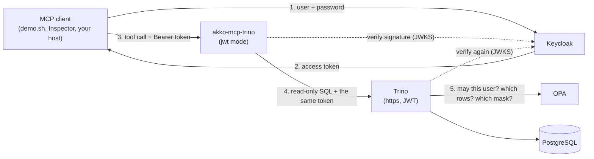

# akko-sandbox

[](https://github.com/AKKO-p/akko-sandbox/actions/workflows/smoke.yml)

<p align="center"></p>

**Two accounts, one question, two answers.** A five minute sandbox for
[akko-mcp-trino](https://github.com/AKKO-p/akko-mcp-trino), the open source MCP
server that gives AI agents read-only access to Trino, each user with their own rights.

[Français](README.fr.md)

Two users ask the same question through MCP. akko-mcp-trino verifies each
user's token and passes it to Trino. Trino verifies it again, runs the query as
that user, and asks a policy what they may see. The analyst gets five European
customers with masked e-mail addresses; the admin gets all ten, in clear. The
server decides none of it.

## Start

You need Docker with Compose v2, about 2 GB of free memory, and the ports
`8080`, `3000` and `6274` free on `localhost`.

```bash
git clone https://github.com/AKKO-p/akko-sandbox.git
cd akko-sandbox
docker compose up -d --wait
./demo.sh
```

The first start downloads the images (about 1.7 GB on disk). After that, the sandbox is
ready in about a minute. Stop it and remove everything with
`docker compose down -v`.

## What `demo.sh` shows

1. The same SQL question, sent by the official MCP client to the `execute_query` tool.
2. `SELECT current_user`: Trino runs each query as the user whose token it received.
3. The two answers side by side: masked e-mails and a row filter for the analyst, everything for the admin.
4. A third user, `dave_viewer`, refused by the policy.
5. A request without a token, and one with a forged signature: both refused with `401`.

`./demo.sh --check` plays the same steps as assertions.

## Users

Demo accounts, with a demo password. Never reuse them anywhere.

| User | Password | Sees |
|---|---|---|
| `alice_admin` | `demo` | every row, every column in clear |
| `carol_analyst` | `demo` | European customers only, e-mail addresses masked |
| `dave_viewer` | `demo` | everything except the customers table |

The Keycloak console is at <http://localhost:8080> (`admin` / `admin`).

## What runs

| Service | Image | Role | Memory limit |
|---|---|---|---|
| `certs` | `alpine/openssl:3.5.9` | creates a demo certificate authority and Trino's certificate, then exits | 32 MB |
| `postgres` | `postgres:17.11-alpine` | the fictional sample data: customers, accounts, transactions | 128 MB |
| `keycloak` | `quay.io/keycloak/keycloak:26.7.5` | the identity provider, realm `sandbox` | 768 MB |
| `opa` | `openpolicyagent/opa:1.21.1-static` | the access policy, [`opa/policy.rego`](opa/policy.rego) | 64 MB |
| `trino` | `trinodb/trino:482` | the engine, https, JWT authentication, OPA access control | 1280 MB |
| `mcp` | `akkoai/akko-mcp-trino:0.5.3` | the MCP server, identity mode `jwt`, strict | 256 MB |
| `inspector` | `ghcr.io/modelcontextprotocol/inspector:2.9.0` | the official MCP Inspector | 384 MB |

Measured on a Linux host with `docker stats`: between 1.3 and 1.4 GB in use at rest,
about 1.5 GB at the peak of the demo. Trino and Keycloak use most of it.

Only Keycloak (`8080`), the MCP server (`3000`) and the Inspector (`6274`) are
published, on `127.0.0.1` only. Set `KEYCLOAK_PORT`, `MCP_PORT` or
`INSPECTOR_PORT` to use other ports.

## How the pieces fit



- The MCP server verifies the token's signature, issuer (`http://localhost:8080/realms/sandbox`), audience (`trino`) and expiry, and refuses a request without one.
- It sends the same token to Trino over https only, checking Trino's certificate against the sandbox CA.
- Trino verifies the token again and runs the query as its `preferred_username`.
- Trino asks OPA before every action. The whole policy is [one short Rego file](opa/policy.rego): who may read what, the e-mail mask, the row filter.

To change what a user sees, edit `opa/policy.rego` and run
`docker compose restart opa`. The MCP server needs no change.

## Click through it: the MCP Inspector

1. Read the Inspector's address and access token: `docker compose logs inspector | grep MCP_INSPECTOR_API_TOKEN`.
2. Open that address. Choose the transport **Streamable HTTP** and the URL `http://mcp:3000/mcp` (the Inspector runs in the compose network).
3. Get a token with `./token.sh carol_analyst` and add the header `Authorization: Bearer <token>`.
4. Connect, then call `execute_query` with `SELECT * FROM demo.crm.customers`. Do it again with alice's token.

## Connect your own MCP host

Claude Desktop, Cursor, VS Code and Claude Code can use the sandbox's server at
`http://localhost:3000/mcp` with a user's token. See
[docs/connect-a-host.md](docs/connect-a-host.md).

## Test

```bash
tests/smoke.sh
```

It starts the sandbox under its own project name, plays the demo, checks the
two different answers, `current_user`, every refusal (the server's door and
Trino's own), the audit line and the Inspector, prints the start time and the
memory, and removes everything. `KEEP=1` leaves it running.

## Not for production

Everything here is chosen to start in one command on a laptop: a development
Keycloak over http, a password grant, one password for every user, a self-signed
certificate authority, a fixed Trino shared secret, a policy with three names in
it. The akko-mcp-trino image and its configuration are the same as in
production; the rest is not.

## About AKKO

akko-mcp-trino is the open source core of AKKO, a French project building a
sovereign data platform with governed AI. See [akko-ai.com](https://akko-ai.com).

## License

[Apache 2.0](LICENSE).
